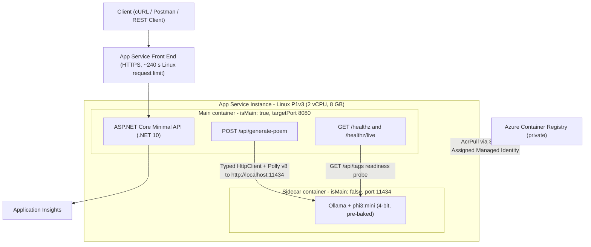

# Tutorial: ASP.NET Core Minimal API (.NET 10) with an SLM Inference Sidecar on Azure App Service

**Audience:** .NET / Azure engineers preparing for Exam AI-200 (Developing AI Cloud Solutions on Azure)
**Tooling:** Visual Studio Code, .NET 10 SDK, Docker Desktop, Azure CLI, Bicep  
**Scenario:** ASP.NET Core Minimal API (`POST /api/generate-poem`) calling a local Phi-3-mini model (Ollama) running as a sidecar container on the same App Service instance

## Document Revision History

| Version | Date | Author | Changes |
|---|---|---|---|
| 1.0 | 2026-11-06 | Peter Morgan | Initial tutorial outline (Azure Functions + sidecar architecture) |
| 1.1 | 2026-11-06 | Peter Morgan | Added VS Code inner-loop workflow. Fixed Dockerfile inline-comment error, added Azurite to Compose, added using directives and FrameworkReference, invalid-JSON handling, model allow-list, `.dockerignore`, revised CLI storage/identity sequence, added Phase 11 and Appendix A. Microsoft Foundry out of scope. |
| 1.2 | 2026-11-06 | Peter Morgan | Replaced Azure Functions with ASP.NET Core Minimal API to align with the documented App Service sidecar scenario. Native `MapHealthChecks`. Removed `AzureWebJobsStorage`, storage account, Azurite and function keys. Added API-key middleware, concurrency limiter (429), ProblemDetails responses, OpenTelemetry/Azure Monitor. Main container port changed to 8080 with non-root user. Updated Bicep, CLI, VS Code tasks/launch configuration, verification and diagnostics. Closed former Appendix A items A1, A2 and A9. |
| 1.3 | 2026-11-06 | Peter Morgan | CLI sidecar creation (Phase 8) now sets `inheritAppSettingsAndConnectionStrings: false` and the `OLLAMA_KEEP_ALIVE` mapping via an ARM PUT, matching Bicep; added inheritance verification to Phases 9 and 11. Model allow-list moved to configuration (`Ollama:AllowedModels`) with startup validation that `DefaultModel` is allowed; updated `appsettings.json`, Compose, Bicep and CLI app settings; added model-change trap to Phase 4. Appendix A: ID policy (no reuse), closed-items table with v1.1 IDs, A2 updated. Revision history dates added. |
| 1.4 | 2026-11-06 | Peter Morgan | Documented the then-configured worst-case queue wait (Phases 2, 3, 9, 10 and Appendix A8): with `QueueLimit = 2` the last queued request could wait ~400 s before inference started, beyond the then-documented 230 s front-end limit; added the sizing rule and the `QueueLimit = 0` option. Introduced a `$MAIN` variable for the main container name (Phase 8) and used it in Phases 10 and 11, since CLI-created apps may not name the main container `api`. Stated the requirement that ACR and the web app share a resource group for `main.bicep` (Phases 6 and 7, Bicep comment), with the cross-resource-group alternative. |
| 1.5 | 2026-11-06 | Peter Morgan | Phase 8 CLI path now applies the same site hardening as `main.bicep` (`httpsOnly`, `minTlsVersion` 1.2, `ftpsState` Disabled), with a Phase 9 check and a Phase 8 trap. Endpoint now handles client disconnects (`OperationCanceledException` when the request is aborted): logged at Information level and excluded from normal server-error handling; added to the status code contract, Phase 3 traps and Phase 10 checklist. Plan name aligned across paths: Phase 6 sets `PLAN=asp-$APP` to match the Bicep naming (`asp-${appName}`). |
| 1.6 | 2026-11-07 | Peter Morgan | Corrected the Linux App Service request limit to approximately 240 seconds; changed inference to fail fast with `QueueLimit = 0`; disabled automatic inference retries; added `Retry-After` for 429 responses; clarified client-abort telemetry; made Entra ID the production authentication recommendation; expanded health-check guidance; added asynchronous processing guidance, automated testing and CI, software-supply-chain controls, model governance, and custom inference telemetry; strengthened image and dependency pinning guidance. |

| 1.7 | 2026-11-07 | Peter Morgan | Corrected retry configuration, container resource API version, inference timeout policy, upstream payload validation, Health check semantics and local port exposure. Added digest resolution and build-argument propagation, exact readiness matching, explicit warm-up, shell/directory/RBAC prerequisites, locked image restore, runnable integration tests and CI, deterministic smoke tests, rollback and cleanup. Clarified API-key authentication and optional production extensions. |

## Completion boundary and validation status

This tutorial builds a synchronous, API-key-protected learning application using VS Code, .NET 10, Ollama and Azure App Service. Microsoft Foundry is not used. Complete Phases 0-6 (run Phase 12 tests as soon as Phase 3 is saved), choose **either Phase 7 (recommended Bicep) or Phase 8 (CLI)**, then complete Phases 9-12. Run Phase 15 only when finished and after retaining any evidence you need. Phases 13-14 are explicitly optional production-extension checklists, not implemented production controls. The asynchronous pattern is a design alternative, not an implementation in this walkthrough.

The core path includes application code, local debugging, image builds, deployment, automated tests, CI, smoke verification, updates, rollback and cleanup. It is not a production security certification or an exam-objective coverage guarantee. API keys remain required throughout the completed core path; Entra migration is out of scope.

**Validation status:** version 1.7 has been statically reviewed for cross-section consistency; fenced Bash blocks were syntax-checked and JSON, XML and YAML examples were parsed. It has not been compiled, container-built or deployed by the document authoring assistant. Run the supplied gates in your environment; do not treat an unexecuted sample as a tested release. Resolve image digests at execution time using Phase 4; no digest or approval is invented here.

## Table of Contents

- [Architecture Overview](#architecture-overview)
- [Phase 0 : Hosting Decision and VS Code Setup](#phase-0--hosting-decision-and-vs-code-setup)
- [Phase 1 : Project Scaffold (.NET 10, C# 14)](#phase-1--project-scaffold-net-10-c-14)
- [Phase 2 : Resilient Typed HttpClient](#phase-2--resilient-typed-httpclient)
- [Phase 3 : Endpoints, Health Checks, Authentication and Concurrency](#phase-3--endpoints-health-checks-authentication-and-concurrency)
- [Phase 4 : Container Images and Model Weight Strategy](#phase-4--container-images-and-model-weight-strategy)
- [Phase 5 : Local Run, Debug and Parity Test](#phase-5--local-run-debug-and-parity-test)
- [Phase 6 : Azure Container Registry and Image Build](#phase-6--azure-container-registry-and-image-build)
- [Phase 7 : Infrastructure as Code (Bicep)](#phase-7--infrastructure-as-code-bicep)
- [Phase 8 : Azure CLI Equivalent](#phase-8--azure-cli-equivalent)
- [Phase 9 : End-to-End Verification](#phase-9--end-to-end-verification)
- [Phase 10 : Observability and Diagnostics](#phase-10--observability-and-diagnostics)
- [Phase 11 : Releasing Updates](#phase-11--releasing-updates)
- [Phase 12: Automated Tests and CI Quality Gates](#phase-12-automated-tests-and-ci-quality-gates)
- [Phase 13 : Software Supply Chain and Model Governance](#phase-13--software-supply-chain-and-model-governance)
- [Phase 14 : Production Telemetry and Alerts](#phase-14--production-telemetry-and-alerts)
- [Phase 15: Cleanup](#phase-15-cleanup)
- [Appendix A : Items to Verify Before Production](#appendix-a--items-to-verify-before-production)
- [References](#references)

## Architecture Overview



**Key principles**

- All containers in a sidecar-enabled app share one network namespace, so the API reaches the model on `localhost:11434`. The model is never exposed publicly.
- Only the main container's `targetPort` receives external traffic.
- All containers on the instance share the plan's memory (8 GB on P1v3).

## Phase 0 : Hosting Decision and VS Code Setup

### Purpose

The API and the model must be co-located on the same instance and communicate over loopback. On App Service this is the **sidecar** model: the web app runs with `linuxFxVersion = SITECONTAINERS`, and each container is a `Microsoft.Web/sites/sitecontainers` resource (one main container plus up to nine sidecars). This mirrors the Microsoft Learn module scenario ("Run sidecar-enabled AI applications on Azure App Service"), replacing its Python/Flask app with ASP.NET Core.

### Why a Minimal API instead of Azure Functions

| Concern | Azure Functions (v1.1) | Minimal API (v1.2) |
|---|---|---|
| Sidecar support | Not confirmed for Function apps | Documented for Linux web apps / custom containers |
| Health endpoints | Implemented as HTTP-triggered functions | Native `MapHealthChecks` |
| Storage dependency | `AzureWebJobsStorage` + RBAC + Azurite | None |
| Base image | Functions host image | Standard `mcr.microsoft.com/dotnet/aspnet:10.0` |
| Authentication | Function keys | API-key middleware in this walkthrough; identity is an optional extension |

### Hosting plan

| Option | Custom container | Sidecars | Verdict |
|---|---|---|---|
| **Linux App Service Plan P1v3 (2 vCPU, 8 GB)** | Yes | Yes | **Recommended minimum** |
| Linux App Service Plan P2v3 (4 vCPU, 16 GB) | Yes | Yes | Use if load testing shows memory or CPU pressure |
| Basic / Standard tiers | Yes | Yes | Not recommended: insufficient memory for the model |

### Compute sizing (P1v3)

| Consumer | Approximate memory |
|---|---|
| Linux OS + App Service platform agents | ~0.5–1 GB |
| ASP.NET Core API | ~0.1–0.3 GB |
| Ollama runtime + phi3:mini (4-bit, ~2.2 GB on disk) incl. KV cache | ~3–4 GB |
| Headroom | ~3 GB |

### VS Code setup

| Extension | Used for |
|---|---|
| C# Dev Kit | .NET 10 / C# 14 editing, project creation and debugging |
| Container Tools (Docker) | Building images, managing the local Ollama container, Build Image in Azure |
| Bicep | Authoring, validation and deployment of Bicep templates |
| Azure Resources / Azure App Service | Log streaming, app settings, opening Kudu |
| REST Client (optional) | `.http` request files as an alternative to Postman |

Workstation prerequisites:

- .NET 10 SDK
- Docker Desktop (Settings → Resources → Memory **≥ 8 GB**)
- Azure CLI (latest), signed in with `az login`

### Terminal, permissions and working-directory contract

Use **Bash** for every shell block: Linux, macOS Bash, or WSL2 Ubuntu on Windows with Docker Desktop WSL integration. PowerShell is not a drop-in replacement. On Windows, open the repository through VS Code's WSL extension and run both .NET and Docker commands in that environment. Install .NET 10 in that environment too. Use Bash as the VS Code default terminal and task shell. All commands run from the repository root unless explicitly stated. Separate terminals must restore their variables as described below.

Required tools: `git`, `curl`, `jq`, `openssl`, `awk`, `sed`, Docker with Compose and Buildx, .NET 10 SDK, Azure CLI and its Bicep support. On Ubuntu, install missing shell utilities with `sudo apt-get update && sudo apt-get install -y git curl jq openssl`; install the SDK, Docker and Azure CLI from their official installation instructions. Verify:

```bash
bash --version
dotnet --list-sdks       # must include a 10.0 SDK
docker version
docker compose version
docker buildx version
az version
az bicep install
az bicep version
for tool in git curl jq openssl awk sed; do command -v "$tool" || exit 1; done
az login
az account show --query '{subscription:name,id:id,tenant:tenantId}' -o table
# If this is not the intended subscription, select it interactively:
az account list --query '[].{name:name,id:id,isDefault:isDefault}' -o table
read -r -p 'Subscription ID to use: ' SUBSCRIPTION_ID
az account set --subscription "$SUBSCRIPTION_ID"
```

Azure prerequisites:

- Permission to create resources in the selected resource group and to create the resource group if needed.
- **Role-assignment write permission** on the registry scope for `AcrPull`: Owner, Role Based Access Control Administrator or User Access Administrator, or a suitably scoped custom role. Contributor alone is insufficient. Ask your Azure administrator to perform the assignment if you lack this permission; do not broaden your own access unnecessarily.
- Permission to run ACR Tasks builds, register required resource providers if not already registered, and create a P1v3 Linux plan in the selected region with available quota. Use a new registry in classic RBAC mode for this tutorial; an existing ABAC-enabled registry needs a different repository-access role model.
- Internet access to Microsoft package feeds, container registries and the model download endpoint. Private-endpoint-only ACR is an optional networking extension, not the completed core path.

Create the workspace, then keep every terminal at this root:

```bash
mkdir poem-sidecar
cd poem-sidecar
git init
mkdir -p .vscode infra sidecar scripts tests docs
printf '%s\n' "$PWD"   # repository root
code .
```

Create `.gitignore`:

```gitignore
**/bin/
**/obj/
.env
.azure.env
artifacts/
TestResults/
*.user
```

Do not ignore `packages.lock.json`. Do not commit API keys, generated access tokens or user secrets. Before Azure work, review estimated P1v3, ACR and monitoring charges; resources continue billing while the web app is stopped.

### Repository layout

```text
poem-sidecar/
├── PoemSidecar.sln
├── .gitignore
├── docs/ollama-base-image.txt
├── scripts/smoke.sh
├── tests/PoemApi.Tests/
├── .github/workflows/ci.yml
├── .vscode/
│   ├── launch.json
│   └── tasks.json
├── infra/
│   └── main.bicep
├── sidecar/
│   └── Dockerfile
├── src/
│   ├── PoemApi.csproj
│   ├── Program.cs
│   ├── Ollama.cs
│   ├── OllamaReadinessCheck.cs
│   ├── ApiKeyMiddleware.cs
│   ├── appsettings.json
│   ├── Properties/launchSettings.json
│   ├── Dockerfile
│   └── .dockerignore
├── compose.yaml
└── requests.http
```

### Traps and production gotchas

- **CPU-only inference is slow.** P1v3 has no GPU. Expect several to tens of seconds per poem. The App Service front end terminates requests at ~240 seconds, so output length must be capped (`num_predict`).
- **One model, one request at a time.** `OLLAMA_NUM_PARALLEL=1` and `OLLAMA_MAX_LOADED_MODELS=1`; more parallelism multiplies KV-cache memory and risks OOM kills.
- **Scale-out duplicates the model.** Every instance runs its own sidecar and model copy. Scale out for throughput, not to reduce memory per instance.

## Phase 1 : Project Scaffold (.NET 10, C# 14)

### Purpose

A Minimal API is the lightest ASP.NET Core hosting model: native dependency injection, configuration, health checks, rate limiting and ProblemDetails, with no additional host runtime.

### Scaffold in VS Code

1. Command Palette → **.NET: New Project…** → **ASP.NET Core Empty** → name `PoemApi` → folder `src`.
2. Replace the generated `.csproj` with the version below.

Terminal equivalent:

```bash
dotnet new web -n PoemApi -o src --framework net10.0
dotnet new sln --name PoemSidecar --format sln
dotnet sln PoemSidecar.sln add src/PoemApi.csproj
```

### src/PoemApi.csproj

```xml
<Project Sdk="Microsoft.NET.Sdk.Web">

  <PropertyGroup>
    <TargetFramework>net10.0</TargetFramework>
    <LangVersion>14</LangVersion>
    <Nullable>enable</Nullable>
    <ImplicitUsings>enable</ImplicitUsings>
    <UserSecretsId>poem-api-local</UserSecretsId>
    <RestorePackagesWithLockFile>true</RestorePackagesWithLockFile>
  </PropertyGroup>

  <ItemGroup>
    <!-- Resolve approved stable versions once, then commit these exact values and packages.lock.json. -->
    <PackageReference Include="Microsoft.Extensions.Http.Resilience" Version="10.0.0" />
    <PackageReference Include="Azure.Monitor.OpenTelemetry.AspNetCore" Version="1.4.0" />
  </ItemGroup>

</Project>
```

### src/appsettings.json

```json
{
  "Logging": {
    "LogLevel": {
      "Default": "Information",
      "Microsoft.AspNetCore": "Warning",
      "Polly": "Warning"
    }
  },
  "AllowedHosts": "*",
  "Ollama": {
    "BaseUrl": "http://localhost:11434",
    "DefaultModel": "phi3:mini",
    "AllowedModels": [ "phi3:mini" ],
    "MaxTokens": 256
  }
}
```

### src/Properties/launchSettings.json

```json
{
  "profiles": {
    "http": {
      "commandName": "Project",
      "applicationUrl": "http://localhost:5080",
      "environmentVariables": {
        "ASPNETCORE_ENVIRONMENT": "Development"
      }
    }
  }
}
```

### Local API key (never commit)

```bash
dotnet user-secrets set --project src/PoemApi.csproj "Api:Key" "local-dev-key-change-me-0123456789abcdef"
```

### Restore and lock dependencies

After saving the project and configuration files, run from the root:

```bash
dotnet restore src/PoemApi.csproj
dotnet restore src/PoemApi.csproj --locked-mode
```

The first command generates `src/packages.lock.json`. Commit it with the project. If a pinned package cannot be restored, stop and resolve the package/version issue; do not silently substitute floating versions. Re-run the build after adding the source files in Phase 3.

### Traps and production gotchas

- **Never place the API key in `appsettings.json`.** Use user secrets locally and an App Service app setting (ideally a Key Vault reference) in Azure.
- **Dependency reproducibility.** The sample uses exact versions and generates `packages.lock.json`. Run `dotnet restore --locked-mode` in CI. Before deployment, confirm that the pinned versions are approved and supported in your organisation; update them through a reviewed dependency pull request rather than floating ranges.

## Phase 2 : Resilient Typed HttpClient

### Purpose

The sidecar can be unavailable during startup (model load) or under memory pressure. A typed `HttpClient` with the standard resilience pipeline (Polly v8 via `Microsoft.Extensions.Http.Resilience`) bounds latency with timeouts and prevents repeated calls to an unhealthy sidecar with a circuit breaker. Automatic retries are disabled because a timed-out inference may continue consuming CPU in Ollama. A separate, non-resilient client is used for health probes so they report the truth quickly.

### src/Ollama.cs

```csharp
using System.ComponentModel.DataAnnotations;
using System.Net.Http.Json;
using System.Text.Json.Serialization;

public sealed class OllamaOptions
{
    public const string Section = "Ollama";

    [Required, Url]
    public string BaseUrl { get; set; } = "http://localhost:11434";

    [Required]
    public string DefaultModel { get; set; } = "phi3:mini";

    // Empty by default: the binder appends configured array items to any initialiser values,
    // so the allowed models are supplied only by configuration (appsettings.json / app settings).
    [MinLength(1)]
    public string[] AllowedModels { get; set; } = [];

    [Range(16, 1024)]
    public int MaxTokens { get; set; } = 256;
}

public sealed record PoemRequest(string? Subject, string? Model);

public sealed record GenerateRequest(
    [property: JsonPropertyName("model")] string Model,
    [property: JsonPropertyName("prompt")] string Prompt,
    [property: JsonPropertyName("stream")] bool Stream,
    [property: JsonPropertyName("options")] Dictionary<string, object> Options);

public sealed record GenerateResponse(
    [property: JsonPropertyName("response")] string? Response,
    [property: JsonPropertyName("done")] bool Done,
    [property: JsonPropertyName("total_duration")] long TotalDuration = 0,
    [property: JsonPropertyName("load_duration")] long LoadDuration = 0,
    [property: JsonPropertyName("prompt_eval_count")] int PromptTokens = 0,
    [property: JsonPropertyName("eval_count")] int OutputTokens = 0);

public sealed class OllamaClient(HttpClient http)
{
    public async Task<string> GenerateAsync(string model, string prompt, int maxTokens, CancellationToken ct)
    {
        var body = new GenerateRequest(model, prompt, Stream: false,
            Options: new() { ["num_predict"] = maxTokens });
        using var response = await http.PostAsJsonAsync("/api/generate", body, ct);
        response.EnsureSuccessStatusCode();
        GenerateResponse? result;
        try
        {
            result = await response.Content.ReadFromJsonAsync<GenerateResponse>(ct);
        }
        catch (System.Text.Json.JsonException ex)
        {
            throw new HttpRequestException("Invalid JSON from inference sidecar.", ex);
        }
        if (result is null || !result.Done || string.IsNullOrWhiteSpace(result.Response))
            throw new HttpRequestException("Incomplete or empty inference response.");

        // Retain upstream token/timing fields in the DTO for optional metrics.
        // Do not log prompt or generated output. Nanosecond timings are not milliseconds.
        return result.Response;
    }
}
```

### Client registration (in Program.cs, see Phase 3)

This is an explanatory excerpt, not an additional file or a second registration. Use the complete Program.cs in Phase 3, including `using Microsoft.Extensions.Http.Resilience;`.

```csharp
builder.Services.AddHttpClient<OllamaClient>((sp, client) =>
{
    var options = sp.GetRequiredService<IOptions<OllamaOptions>>().Value;
    client.BaseAddress = new Uri(options.BaseUrl);
    client.Timeout = Timeout.InfiniteTimeSpan; // Polly owns all timeouts
})
.AddStandardResilienceHandler(o =>
{
    // Test-only overrides are supplied by WebApplicationFactory, never by API callers.
    var attemptSeconds = builder.Configuration.GetValue("Inference:AttemptTimeoutSeconds", 190);
    var totalSeconds = builder.Configuration.GetValue("Inference:TotalTimeoutSeconds", 200);
    if (attemptSeconds < 1 || totalSeconds <= attemptSeconds || totalSeconds > 200)
        throw new InvalidOperationException("Require 1 <= attempt < total <= 200 seconds.");
    o.AttemptTimeout.Timeout = TimeSpan.FromSeconds(attemptSeconds);
    o.TotalRequestTimeout.Timeout = TimeSpan.FromSeconds(totalSeconds);    // retains margin below the ~240 s Linux front-end limit
    o.Retry.DisableForUnsafeHttpMethods(); // never replay an inference POST
    o.Retry.Delay = TimeSpan.FromSeconds(2);
    o.CircuitBreaker.SamplingDuration = TimeSpan.FromSeconds(2 * attemptSeconds); // must be >= 2 x AttemptTimeout
    o.CircuitBreaker.FailureRatio = 0.5;
    o.CircuitBreaker.MinimumThroughput = 5;
    o.CircuitBreaker.BreakDuration = TimeSpan.FromSeconds(30);
});

builder.Services.AddHttpClient("ollama-probe", (sp, client) =>
{
    var options = sp.GetRequiredService<IOptions<OllamaOptions>>().Value;
    client.BaseAddress = new Uri(options.BaseUrl);
    client.Timeout = TimeSpan.FromSeconds(3);
});
```

### Traps and production gotchas

- **`HttpClient.Timeout` default (100 s)** fires before Polly's timeouts and surfaces as `TaskCanceledException`. Set it to `Timeout.InfiniteTimeSpan` with the resilience handler.
- **Startup validation.** The standard handler validates `SamplingDuration ≥ 2 × AttemptTimeout` and `AttemptTimeout < TotalRequestTimeout`; violations fail the app at startup.
- **Do not retry expensive inference automatically.** After an attempt timeout, Ollama may still be generating. A retry can duplicate CPU work and queue behind the original call. This tutorial calls `DisableForUnsafeHttpMethods()` so inference POSTs are not replayed; callers may retry a later `502`, `503`, `504`, or `429` according to their own bounded policy.
- **`TotalRequestTimeout` bounds one request's sidecar call, not its end-to-end time.** The 200 s budget starts only when the request leaves the concurrency limiter queue (Phase 3). Time spent queued is added on top, so a queued request can exceed the 240 s front-end limit even though every sidecar attempt stays within 190 s.
- **Idempotency is not sufficient justification for retry.** Although generation has no durable business side effect, it consumes scarce CPU and memory. Treat retry as a capacity decision as well as a correctness decision.
- **Use `stream: false`** with this client; streaming requires a different design.

## Phase 3 : Endpoints, Health Checks, Authentication and Concurrency

### Purpose

- Separate **liveness** (process running) from **readiness** (sidecar reachable and model present) using native `MapHealthChecks`.
- Use an API key for the tutorial and local testing, keeping health endpoints anonymous. For production organisational callers, prefer Microsoft Entra ID through App Service Authentication or JWT bearer authentication with explicit audience and scope validation.
- Limit concurrent inference per instance to match the sidecar's single-request capacity, returning 429 instead of piling requests onto Ollama.
- Map resilience outcomes to correct HTTP status codes using ProblemDetails.

### src/OllamaReadinessCheck.cs

```csharp
using System.Net.Http.Json;
using Microsoft.Extensions.Diagnostics.HealthChecks;
using Microsoft.Extensions.Options;

public sealed class OllamaReadinessCheck(IHttpClientFactory factory, IOptions<OllamaOptions> options)
    : IHealthCheck
{
    private sealed record TagsResponse(List<ModelTag> Models);
    private sealed record ModelTag(string Name);

    public async Task<HealthCheckResult> CheckHealthAsync(
        HealthCheckContext context, CancellationToken ct = default)
    {
        try
        {
            var tags = await factory.CreateClient("ollama-probe")
                .GetFromJsonAsync<TagsResponse>("/api/tags", ct);

            var model = options.Value.DefaultModel;
            var present = tags?.Models?.Any(m =>
                string.Equals(m.Name, model, StringComparison.Ordinal)) == true;

            return present
                ? HealthCheckResult.Healthy($"Sidecar reachable; {model} present")
                : HealthCheckResult.Unhealthy($"Sidecar reachable; {model} missing");
        }
        catch (Exception ex)
        {
            return HealthCheckResult.Unhealthy("Sidecar unreachable on loopback", ex);
        }
    }
}
```

Readiness means **Ollama reachable and the exact canonical model name installed**, not loaded into memory and not proven to generate successfully. Use the explicit Phase 9 warm-up for release verification. Model identifiers in configuration and requests are case-sensitive in this tutorial.

### src/ApiKeyMiddleware.cs

```csharp
using System.ComponentModel.DataAnnotations;
using System.Security.Cryptography;
using System.Text;
using Microsoft.Extensions.Options;

public sealed class ApiKeyOptions
{
    public const string Section = "Api";

    [Required, MinLength(32)]
    public string Key { get; set; } = string.Empty;
}

public sealed class ApiKeyMiddleware(RequestDelegate next, IOptions<ApiKeyOptions> options)
{
    private const string HeaderName = "x-api-key";
    private readonly byte[] _expected = Encoding.UTF8.GetBytes(options.Value.Key);

    public async Task InvokeAsync(HttpContext context)
    {
        var provided = Encoding.UTF8.GetBytes(context.Request.Headers[HeaderName].ToString());

        if (!CryptographicOperations.FixedTimeEquals(provided, _expected))
        {
            await Results.Problem(
                statusCode: StatusCodes.Status401Unauthorized,
                title: "Missing or invalid API key.")
                .ExecuteAsync(context);
            return;
        }

        await next(context);
    }
}
```

### src/Program.cs

```csharp
using System.Threading.RateLimiting;
using Azure.Monitor.OpenTelemetry.AspNetCore;
using Microsoft.AspNetCore.Diagnostics.HealthChecks;
using Microsoft.Extensions.Diagnostics.HealthChecks;
using Microsoft.Extensions.Options;
using Microsoft.Extensions.Http.Resilience;
using Polly.CircuitBreaker;
using Polly.Timeout;

var builder = WebApplication.CreateBuilder(args);

// Telemetry: enabled only when a connection string is configured (UseAzureMonitor throws without one)
if (!string.IsNullOrWhiteSpace(builder.Configuration["APPLICATIONINSIGHTS_CONNECTION_STRING"]))
{
    builder.Services.AddOpenTelemetry().UseAzureMonitor();
}

builder.Services.AddProblemDetails();

// Options
builder.Services.AddOptions<OllamaOptions>()
    .Bind(builder.Configuration.GetSection(OllamaOptions.Section))
    .ValidateDataAnnotations()
    .Validate(o => o.AllowedModels.Contains(o.DefaultModel, StringComparer.Ordinal),
        "Ollama:DefaultModel must be listed in Ollama:AllowedModels.")
    .ValidateOnStart();

builder.Services.AddOptions<ApiKeyOptions>()
    .Bind(builder.Configuration.GetSection(ApiKeyOptions.Section))
    .ValidateDataAnnotations()
    .ValidateOnStart();

// Inference client: full resilience pipeline
builder.Services.AddHttpClient<OllamaClient>((sp, client) =>
{
    var options = sp.GetRequiredService<IOptions<OllamaOptions>>().Value;
    client.BaseAddress = new Uri(options.BaseUrl);
    client.Timeout = Timeout.InfiniteTimeSpan;
})
.AddStandardResilienceHandler(o =>
{
    // Test-only overrides are supplied by WebApplicationFactory, never by API callers.
    var attemptSeconds = builder.Configuration.GetValue("Inference:AttemptTimeoutSeconds", 190);
    var totalSeconds = builder.Configuration.GetValue("Inference:TotalTimeoutSeconds", 200);
    if (attemptSeconds < 1 || totalSeconds <= attemptSeconds || totalSeconds > 200)
        throw new InvalidOperationException("Require 1 <= attempt < total <= 200 seconds.");
    o.AttemptTimeout.Timeout = TimeSpan.FromSeconds(attemptSeconds);
    o.TotalRequestTimeout.Timeout = TimeSpan.FromSeconds(totalSeconds);
    o.Retry.DisableForUnsafeHttpMethods(); // never replay an inference POST
    o.Retry.Delay = TimeSpan.FromSeconds(2);
    o.CircuitBreaker.SamplingDuration = TimeSpan.FromSeconds(2 * attemptSeconds);
    o.CircuitBreaker.FailureRatio = 0.5;
    o.CircuitBreaker.MinimumThroughput = 5;
    o.CircuitBreaker.BreakDuration = TimeSpan.FromSeconds(30);
});

// Probe client: no retries, short timeout
builder.Services.AddHttpClient("ollama-probe", (sp, client) =>
{
    var options = sp.GetRequiredService<IOptions<OllamaOptions>>().Value;
    client.BaseAddress = new Uri(options.BaseUrl);
    client.Timeout = TimeSpan.FromSeconds(3);
});

// Health checks
builder.Services.AddHealthChecks()
    .AddCheck<OllamaReadinessCheck>("ollama", tags: ["ready"]);

// Concurrency limiter: matches OLLAMA_NUM_PARALLEL=1 (per instance).
// Fail fast while the single inference permit is occupied. This keeps accepted requests
// within the application timeout and avoids hidden queue time behind the App Service front end.
builder.Services.AddRateLimiter(o =>
{
    o.RejectionStatusCode = StatusCodes.Status429TooManyRequests;
    o.OnRejected = async (context, cancellationToken) =>
    {
        context.HttpContext.Response.Headers.RetryAfter = "5";
        await Results.Problem(
            statusCode: StatusCodes.Status429TooManyRequests,
            title: "Inference capacity is busy. Retry later.")
            .ExecuteAsync(context.HttpContext);
    };
    o.AddConcurrencyLimiter("inference", l =>
    {
        l.PermitLimit = 1;
        l.QueueLimit = 0;
        l.QueueProcessingOrder = QueueProcessingOrder.OldestFirst;
    });
});

var app = builder.Build();

app.UseExceptionHandler();
app.UseStatusCodePages();

// API key applies to /api/* only; health endpoints stay anonymous for platform probes.
// Registered before the rate limiter so unauthenticated calls never occupy an inference slot.
app.UseWhen(
    ctx => ctx.Request.Path.StartsWithSegments("/api"),
    branch => branch.UseMiddleware<ApiKeyMiddleware>());

app.UseRateLimiter();

// Health endpoints
app.MapHealthChecks("/healthz/live", new HealthCheckOptions
{
    Predicate = _ => false,              // process liveness only
    ResponseWriter = WriteHealthAsync
});

app.MapHealthChecks("/healthz", new HealthCheckOptions
{
    Predicate = r => r.Tags.Contains("ready"),
    ResponseWriter = WriteHealthAsync
});

app.MapPost("/api/generate-poem", async (
        PoemRequest input,
        OllamaClient ollama,
        IOptions<OllamaOptions> options,
        ILogger<Program> log,
        CancellationToken ct) =>
    {
        if (string.IsNullOrWhiteSpace(input.Subject) || input.Subject.Length > 200)
            return Results.Problem(statusCode: 400, title: "subject is required (max 200 characters).");

        var model = string.IsNullOrWhiteSpace(input.Model) ? options.Value.DefaultModel : input.Model;

        // Allow-list (from configuration) prevents callers from forcing Ollama to load arbitrary models
        if (!options.Value.AllowedModels.Contains(model, StringComparer.Ordinal))
            return Results.Problem(statusCode: 400, title: $"model '{model}' is not permitted.");

        try
        {
            var poem = await ollama.GenerateAsync(
                model,
                $"Write a short four-line poem about {input.Subject}.",
                options.Value.MaxTokens,
                ct);

            return Results.Ok(new { subject = input.Subject, model, poem });
        }
        catch (BrokenCircuitException)
        {
            return Results.Problem(statusCode: 503, title: "Inference sidecar temporarily unavailable.");
        }
        catch (TimeoutRejectedException)
        {
            return Results.Problem(statusCode: 504, title: "Inference timed out.");
        }
        catch (HttpRequestException ex)
        {
            log.LogError(ex, "Sidecar call failed (automatic inference retries disabled)");
            return Results.Problem(statusCode: 502, title: "Inference sidecar returned an error.");
        }
        catch (OperationCanceledException) when (ct.IsCancellationRequested)
        {
            // The caller (or the App Service front end) closed the connection; nobody receives this response.
            // No reliable HTTP response can be delivered after disconnect.
            // Polly timeouts surface as TimeoutRejectedException, caught above.
            log.LogInformation("Client disconnected before the poem was generated");
            return Results.Empty; // the connection is already closed; no response status is dependable
        }
    })
    .RequireRateLimiting("inference");

app.Run();

static Task WriteHealthAsync(HttpContext context, HealthReport report) =>
    context.Response.WriteAsJsonAsync(new
    {
        status = report.Status.ToString(),
        checks = report.Entries.ToDictionary(e => e.Key, e => e.Value.Description)
    });

// Expose the entry point to WebApplicationFactory in the test project.
public partial class Program { }
```

### Build checkpoint and timeout policy

```bash
dotnet build src/PoemApi.csproj --no-restore
```

The effective inference attempt limit is **190 seconds**. The outer resilience budget is **200 seconds**, leaving headroom below the approximate Linux front-end limit. There are no automatic inference POST retries. Circuit sampling is 380 seconds, twice the attempt timeout. Both attempt and total timeout produce 504. The outer budget is not a promise that a single attempt runs for 200 seconds. Cancellation requests are propagated, but a remote model server may not immediately stop all compute after a disconnected client; measure that behaviour under load.

### Status code contract

| Condition | HTTP status |
|---|---|
| Poem generated | 200 |
| Invalid/empty JSON body (framework binding) | 400 |
| Missing/oversized subject, model not allowed | 400 |
| Missing or invalid `x-api-key` | 401 |
| Inference slot and inference permit busy on this instance | 429 |
| Sidecar connection, HTTP or response-payload error (no automatic inference retries) | 502 |
| Circuit breaker open | 503 |
| Attempt or total request timeout exceeded | 504 |
| `/healthz` with sidecar unreachable or model missing | 503 |

### Queue sizing and the 240-second limit

The App Service front end ends any request at ~240 seconds, measured from when the client's request arrives. That time includes waiting in the limiter queue as well as the sidecar call. Because only one request runs at a time, each queued request waits for every request ahead of it:

| Position on the instance | Wait before inference starts (worst case) | Worst-case total |
|---|---|---|
| Running (permit holder) | 0 s | 190 s |
| Queue position 1 | up to 190 s | up to 380 s |
| Queue position 2 | up to 380 s | up to 570 s |

Worst-case application queue wait is `QueueLimit × measured worst-case generation latency`. With the tutorial default (`QueueLimit = 0`), an accepted request starts immediately and is bounded by the 190-second attempt limit inside a 200-second outer budget. A concurrent request receives 429 instead of waiting invisibly behind the App Service front end. Use load-test evidence before enabling any queue:

| Setting | Behaviour | Use when |
|---|---|---|
| `QueueLimit = 0` (**tutorial default**) | No application queue; a request arriving while inference is running receives an immediate 429 with `Retry-After: 5` | Recommended for predictable latency and constrained CPU-only inference |
| `QueueLimit = 1` | Absorbs one queued request | Use only when measured P99 queue wait plus generation remains materially below ~240 s |
| `QueueLimit > 1` | Absorbs larger bursts but increases hidden latency and timeout risk | Generally avoid for synchronous App Service inference; prefer an asynchronous queue-backed API |

### Synchronous versus asynchronous production API

The synchronous endpoint is retained because it is easy to understand and suitable when measured P95 and P99 generation times remain comfortably below the 190-second inference attempt timeout. Do not design a production service around routinely holding an HTTP connection near the App Service platform limit.

Use an asynchronous operation pattern when generation can be long-running, bursty, or business-critical:

1. `POST /api/poems` validates the request and returns `202 Accepted`.
2. The response includes an operation resource such as `/api/operations/{operationId}`.
3. The API writes a message to Azure Service Bus or Azure Queue Storage.
4. A worker performs inference and stores the result and status in durable storage.
5. The caller polls the operation resource or receives a webhook/event when processing completes.

This separates HTTP lifetime from inference lifetime, provides durable back-pressure, and supports controlled retry and dead-letter handling. Keep the synchronous endpoint only when load tests demonstrate adequate margin.

### Traps and production gotchas

- **App Service Health check path.** Pointing Health check at `/healthz` (readiness) can mark affected instances unhealthy; it does not immediately or indefinitely replace them. If every instance is unhealthy, Health check does not remove all instances from routing. Choose deliberately: `/healthz/live` detects a wedged API process without coupling platform replacement to model readiness; `/healthz` keeps an instance out of rotation when Ollama or the required model is unavailable. With two or more instances and proven cold-start behaviour, `/healthz` may be the better availability choice. Use `/healthz` as an installed-model check, followed by the explicit warm-up and inference smoke test in Phase 9 before accepting a release.
- **Single-instance Health check.** An unhealthy single instance is not removed from load balancing, but may be replaced after one hour of continuous unhealthy checks, subject to platform limits. Two or more active instances are needed for traffic rerouting benefits. Replacement is not immediate and is limited to one instance per hour and three per day per plan.
- **Never run inference in a recurring probe.** `/api/tags` is cheap; `/api/generate` is not.
- **The limiter applies per instance, and time spent queued counts toward the 240 s limit.** With the tutorial default `QueueLimit = 0`, requests fail fast rather than waiting behind a long-running inference. If the front end ends a request first, the client gets a front-end timeout, not the API's 504 ProblemDetails. Size `QueueLimit` from measured generation latency (table above).
- **The allow-list and the default model are checked together at startup.** If `Ollama:DefaultModel` is not in `Ollama:AllowedModels`, the API container fails to start (`ValidateOnStart`). Without this check, every request that omits `model` would get a 400.
- **Client disconnects are not dependable API responses.** The endpoint token is `HttpContext.RequestAborted`. The handler logs aborted work separately and avoids treating it as a normal 500. Because the connection has already closed, do not promise a 499 or any other status to the caller; inspect telemetry instead. The filter does not catch Polly timeouts.
- **Middleware order matters.** API-key checks run before the rate limiter, so unauthenticated requests are rejected without consuming an inference slot.
- **Authentication boundary.** The completed tutorial always requires an API key, locally and in Azure. Do not enable Easy Auth and assume it replaces the middleware: it would add another authentication layer. A future Entra migration must conditionally remove API-key validation, configure token audience and scopes/roles, preserve a safe probe path, and test 401 and 403. That migration is outside the core walkthrough; no production identity implementation is claimed.

## Phase 4 : Container Images and Model Weight Strategy

### Purpose

Model weights determine cold-start behaviour. Downloading ~2 GB on every container start risks exceeding the start-time limit and makes startup depend on external network availability.

### Weight management options

| Pattern | Cold start | Operations | Verdict |
|---|---|---|---|
| **Pre-baked into the sidecar image** | Image pull (~2.5 GB+), then fast local load | Rebuild image to change model | **Recommended** |
| Azure Files mount (`OLLAMA_MODELS` on a mounted share) | Small image, but model loaded over SMB (slow) | Change models without rebuilding | Only when models change frequently |
| Download at runtime (`ollama pull` on start) | Download on every start; timeout risk | External dependency at startup | Avoid |

### src/Dockerfile : API main container (multi-stage)

```dockerfile
# Build stage
FROM mcr.microsoft.com/dotnet/sdk:10.0 AS build
WORKDIR /src
COPY *.csproj packages.lock.json ./
RUN dotnet restore --locked-mode
COPY . .
RUN dotnet publish -c Release -o /app/publish --no-restore /p:UseAppHost=false

# Runtime stage
FROM mcr.microsoft.com/dotnet/aspnet:10.0
WORKDIR /app
COPY --from=build /app/publish .
# .NET 8+ images listen on 8080 by default (ASPNETCORE_HTTP_PORTS=8080)
EXPOSE 8080
# Run as the built-in non-root user
USER $APP_UID
ENTRYPOINT ["dotnet", "PoemApi.dll"]
```

### src/.dockerignore

```text
bin/
obj/
.vscode/
Properties/launchSettings.json
*.user
```

### Resolve the Ollama base image once, before any sidecar build

This executable bootstrap resolves a real registry digest instead of inventing one. `latest` is used **only to discover a candidate**, not as the build reference. For production, substitute your organisation's approved release tag before running this block and approve the resolved digest after testing. Discovery does not constitute approval.

```bash
OLLAMA_TAG=latest
OLLAMA_DIGEST=$(docker buildx imagetools inspect "ollama/ollama:$OLLAMA_TAG" \
  | awk '$1 == "Digest:" { print $2; exit }')
[[ "$OLLAMA_DIGEST" =~ ^sha256:[0-9a-f]{64}$ ]] || { echo 'Digest resolution failed'; exit 1; }
OLLAMA_IMAGE="ollama/ollama@$OLLAMA_DIGEST"
printf 'OLLAMA_IMAGE=%s\n' "$OLLAMA_IMAGE" > .env
printf '%s\n' "$OLLAMA_IMAGE" > docs/ollama-base-image.txt
export OLLAMA_IMAGE
```

Keep `.env` untracked. Commit `docs/ollama-base-image.txt` as the release input. In a new terminal run `source .env`. Every build below passes this reference explicitly. Model tags can also change: the baked sidecar image digest is the deployable artifact; capture the full model digest in Phase 9 and promote the already-built sidecar rather than re-pulling the model for each environment.

### sidecar/Dockerfile : Ollama with pre-baked phi3:mini

```dockerfile
# Pin an explicit Ollama version tag for production builds
ARG OLLAMA_IMAGE
# Required: pass the digest-pinned reference resolved below.
FROM ${OLLAMA_IMAGE}

SHELL ["/bin/bash", "-c"]
ENV OLLAMA_MODELS=/models

# Start the server temporarily, wait until it responds, pull the model, then stop it
RUN set -e; ollama serve & PID=$!; \
    trap 'kill "$PID" 2>/dev/null || true' EXIT; \
    READY=0; for i in {1..60}; do \
      if ollama list >/dev/null 2>&1; then READY=1; break; fi; sleep 1; \
    done; test "$READY" = 1; \
    ollama pull phi3:mini; \
    ollama list

ENV OLLAMA_HOST=0.0.0.0:11434 \
    OLLAMA_KEEP_ALIVE=-1 \
    OLLAMA_NUM_PARALLEL=1 \
    OLLAMA_MAX_LOADED_MODELS=1

EXPOSE 11434
```

The base image's entrypoint (`ollama serve`) is inherited, so no `CMD`/`ENTRYPOINT` is needed.

### Traps and production gotchas

- **Port 8080, not 80.** The main container's `targetPort` must be 8080. A non-root user cannot bind port 80 without additional configuration; keep 8080.
- **Dockerfile comments must be on their own line.** Trailing `# comment` text after an instruction is parsed as arguments.
- **`OLLAMA_KEEP_ALIVE=-1`** keeps the model resident permanently (avoids reload after the default 5 minutes idle) but never releases that memory.
- **Pin before build.** Use the resolved `OLLAMA_IMAGE` from the steps above. Record and approve it before production promotion. Tag-only pinning is weaker because tags can be moved.
- **Image size.** The sidecar image is several GB; its first pull on a new instance dominates cold-start time.
- **Changing the model touches three places.** Rebuild the sidecar image with the new model (`ollama pull` in `sidecar/Dockerfile`), and update both `Ollama__DefaultModel` and `Ollama__AllowedModels__0` (plus `appsettings.json` and `compose.yaml`). `/healthz` reports "model missing" if the image and `DefaultModel` disagree; startup fails if `DefaultModel` is not in `AllowedModels`.

## Phase 5 : Local Run, Debug and Parity Test

### Purpose

Two local modes: **Mode A** for fast debugging with breakpoints, **Mode B** to test the real container images and the shared-loopback network model used by App Service.

### Mode A : F5 debugging (day-to-day)

Ollama runs in Docker; the API runs natively under the VS Code debugger.

```bash
source .env
docker build --platform linux/amd64 --build-arg OLLAMA_IMAGE="$OLLAMA_IMAGE" -t ollama-phi3:dev ./sidecar
docker run -d --name ollama -p 127.0.0.1:11434:11434 --memory 6g ollama-phi3:dev
```

Because port 11434 is published to the host, `http://localhost:11434` works exactly as on App Service.

**.vscode/tasks.json**

```json
{
  "version": "2.0.0",
  "tasks": [
    {
      "label": "ollama: start",
      "type": "shell",
      "command": "docker start ollama || docker run -d --name ollama -p 127.0.0.1:11434:11434 --memory 6g ollama-phi3:dev",
      "problemMatcher": []
    }
  ]
}
```

**.vscode/launch.json** (C# Dev Kit)

```json
{
  "version": "0.2.0",
  "configurations": [
    {
      "name": "PoemApi + Ollama sidecar",
      "type": "dotnet",
      "request": "launch",
      "projectPath": "${workspaceFolder}/src/PoemApi.csproj",
      "preLaunchTask": "ollama: start"
    }
  ]
}
```

Press **F5**; breakpoints work in the endpoint handler, `ApiKeyMiddleware` and `OllamaReadinessCheck`.

Terminal alternative (keep the terminal running; use another root terminal for requests):

```bash
dotnet run --project src/PoemApi.csproj --launch-profile http
```

Mode A uses port 5080. Do not run the debugger and this terminal command simultaneously. After saving Phase 9's smoke script, set `BASE=http://localhost:5080` and the development API key, export both, then run `bash scripts/smoke.sh`.


**requests.http** (REST Client)

```http
@base = http://localhost:5080
@key = local-dev-key-change-me-0123456789abcdef

### Liveness
GET {{base}}/healthz/live

### Readiness (sidecar + model)
GET {{base}}/healthz

### Generate poem
POST {{base}}/api/generate-poem
x-api-key: {{key}}
Content-Type: application/json

{ "subject": "Tauranga harbour at dawn", "model": "phi3:mini" }
```

### Mode B : Container parity test (Docker Compose)

The API shares the Ollama container's network namespace, replicating App Service's shared loopback.

**compose.yaml**

```yaml
services:
  ollama:
    platform: linux/amd64
    build:
      context: ./sidecar
      args:
        OLLAMA_IMAGE: ${OLLAMA_IMAGE:?Run Phase 4 digest resolution first}
    ports:
      - "127.0.0.1:8080:8080"      # API (published on the namespace owner)
    deploy:
      resources:
        limits:
          memory: 6g

  api:
    platform: linux/amd64
    build: ./src
    network_mode: "service:ollama"   # shares loopback, like App Service
    environment:
      ASPNETCORE_ENVIRONMENT: "Development"
      Api__Key: "local-dev-key-change-me-0123456789abcdef"
      Ollama__BaseUrl: "http://localhost:11434"
      Ollama__DefaultModel: "phi3:mini"
      Ollama__AllowedModels__0: "phi3:mini"
    depends_on: [ollama]
```

```bash
# Stop Mode A first; otherwise the named container/ports can conflict.
docker rm -f ollama 2>/dev/null || true
# Stop the native API debugger before starting Compose.
docker compose config --quiet
docker compose up --build -d
BASE=http://localhost:8080
API_KEY=local-dev-key-change-me-0123456789abcdef
# Run scripts/smoke.sh from Phase 9 after saving it.
# Until then inspect logs and /healthz; startup is not ordered by depends_on.
docker compose logs --tail 100
curl -i "$BASE/healthz"
```

### Traps and production gotchas

- **Loopback parity.** Without `network_mode: service:…`, `localhost` refers only to the container itself. Switching to `http://ollama:11434` "fixes" Compose but fails on App Service.
- **Ports in a shared namespace.** Publish ports on the namespace owner (`ollama`), not on the service using `network_mode`.
- **User secrets are not available in containers.** Mode B passes `Api__Key` as an environment variable; startup fails fast (`ValidateOnStart`) if it is missing or shorter than 32 characters.
- **First request is slow.** The model loads into memory on first use (10–30+ seconds on CPU).
- **Docker Desktop memory** below ~8 GB causes the same OOM kills you would see in Azure.
- **Windows shells.** `||` in the `ollama: start` task requires PowerShell 7+ or bash; on Windows PowerShell 5.1, configure the task to use `pwsh` or Git Bash.

## Phase 6 : Azure Container Registry and Image Build

### Purpose

An authenticated ACR with the admin user disabled, pulled via managed identity (AcrPull), removes registry credentials from configuration entirely.

The registry is created in the **same resource group** as the web app (`$RG`). `main.bicep` (Phase 7) requires this; see the Phase 7 traps if the registry must live elsewhere.

```bash
source .env
az provider register --namespace Microsoft.Web --wait
az provider register --namespace Microsoft.ContainerRegistry --wait
az provider register --namespace Microsoft.Insights --wait
az provider register --namespace Microsoft.OperationalInsights --wait
RG=rg-poem-ai
LOC=australiaeast
ACR=acrpoem$RANDOM
APP=app-poem-$RANDOM
PLAN=asp-$APP          # matches main.bicep naming: asp-${appName}

az group create -n $RG -l $LOC
az acr create -g $RG -n $ACR --sku Standard --admin-enabled false

# Persist non-secret deployment coordinates for subsequent terminals.
printf 'RG=%q\nLOC=%q\nACR=%q\nAPP=%q\nPLAN=%q\n' \
  "$RG" "$LOC" "$ACR" "$APP" "$PLAN" > .azure.env
# Keep API_KEY in the active terminal only; do not write it to this file.
az acr build -r "$ACR" -t poem-api:1.0 --platform linux/amd64 ./src
az acr build -r "$ACR" -t ollama-phi3:1.0 --platform linux/amd64 \
  --build-arg OLLAMA_IMAGE="$OLLAMA_IMAGE" ./sidecar
```

**VS Code:** run the commands above in the integrated Bash terminal. Do not use an extension build shortcut unless it also supplies the required `OLLAMA_IMAGE` build argument.

### Traps and production gotchas

- **Cloud builds avoid uploading baked model weights.** The ACR build downloads them in Azure. Allow for image size, network access and build duration.
- **Use unique release tags** (`1.0`, `1.1`, or a commit SHA), not `latest`; do not overwrite them. A tag name alone does not enforce immutability.
- **Network-restricted ACR.** If the registry is private-endpoint-only, the app needs VNet integration with image pull over VNet enabled.
- **Plan naming.** `PLAN=asp-$APP` gives the same plan name as `main.bicep` (`asp-${appName}`), so the Bicep and CLI paths produce identically named resources. Set `APP` before `PLAN`.
- **Registry location.** Create the registry in `$RG`, the resource group that `main.bicep` is deployed to. A shared registry in another resource group needs the cross-resource-group pattern in Phase 7.

## Phase 7 : Infrastructure as Code (Bicep)

**Recommended deployment path.** Complete this phase OR Phase 8, never both on the same learning deployment. After this phase continue at Phase 9. In a new terminal, run `source .azure.env` and `source .env`.

### Purpose

Declarative definition of the plan, the web app in `SITECONTAINERS` mode, Application Insights, the AcrPull role assignment and both containers as `Microsoft.Web/sites/sitecontainers` resources.

**Prerequisite:** the registry named by `acrName` must already exist in the **same resource group** as the deployment. The template looks up the registry with `existing` at the deployment's resource-group scope and assigns AcrPull with `scope: acr`. Both only work when the registry and the app share a resource group.

### infra/main.bicep

```bicep
param location string = resourceGroup().location
param appName string

// Must be an existing registry in THIS resource group (see Phase 7 prerequisite)
param acrName string

param apiImageTag string = '1.0'
param slmImageTag string = '1.0'

@secure()
@minLength(32)
param apiKey string

var acrPullRoleId = '7f951dda-4ed3-4680-a7ca-43fe172d538d'

// Resolved in the deployment's resource group; the AcrPull assignment below uses this as its scope
resource acr 'Microsoft.ContainerRegistry/registries@2023-07-01' existing = {
  name: acrName
}

resource appInsights 'Microsoft.Insights/components@2020-02-02' = {
  name: 'appi-${appName}'
  location: location
  kind: 'web'
  properties: { Application_Type: 'web' }
}

resource plan 'Microsoft.Web/serverfarms@2024-04-01' = {
  name: 'asp-${appName}'
  location: location
  kind: 'linux'
  sku: { name: 'P1v3', tier: 'PremiumV3' }
  properties: { reserved: true }
}

resource site 'Microsoft.Web/sites@2024-04-01' = {
  name: appName
  location: location
  kind: 'app,linux,container'
  identity: { type: 'SystemAssigned' }
  properties: {
    serverFarmId: plan.id
    httpsOnly: true
    siteConfig: {
      linuxFxVersion: 'SITECONTAINERS'
      acrUseManagedIdentityCreds: true
      alwaysOn: true
      healthCheckPath: '/healthz/live'
      ftpsState: 'Disabled'
      minTlsVersion: '1.2'
      appSettings: [
        { name: 'APPLICATIONINSIGHTS_CONNECTION_STRING', value: appInsights.properties.ConnectionString }
        { name: 'WEBSITES_ENABLE_APP_SERVICE_STORAGE', value: 'false' }
        { name: 'WEBSITES_CONTAINER_START_TIME_LIMIT', value: '1800' }
        { name: 'Api__Key', value: apiKey }
        { name: 'Ollama__BaseUrl', value: 'http://localhost:11434' }
        { name: 'Ollama__DefaultModel', value: 'phi3:mini' }
        { name: 'Ollama__AllowedModels__0', value: 'phi3:mini' }   // array index syntax; add __1, __2 for more
        { name: 'Ollama__MaxTokens', value: '256' }
        { name: 'OLLAMA_KEEP_ALIVE', value: '-1' }
      ]
    }
  }
}

resource acrPull 'Microsoft.Authorization/roleAssignments@2022-04-01' = {
  scope: acr
  name: guid(acr.id, site.id, acrPullRoleId)
  properties: {
    roleDefinitionId: subscriptionResourceId('Microsoft.Authorization/roleDefinitions', acrPullRoleId)
    principalId: site.identity.principalId
    principalType: 'ServicePrincipal'
  }
}

resource mainContainer 'Microsoft.Web/sites/sitecontainers@2025-03-01' = {
  parent: site
  name: 'api'
  properties: {
    image: '${acr.properties.loginServer}/poem-api:${apiImageTag}'
    isMain: true
    targetPort: '8080'                         // replaces WEBSITES_PORT in sitecontainers mode
    authType: 'SystemIdentity'
    inheritAppSettingsAndConnectionStrings: true
  }
  dependsOn: [ acrPull ]
}

resource slmSidecar 'Microsoft.Web/sites/sitecontainers@2025-03-01' = {
  parent: site
  name: 'ollama'
  properties: {
    image: '${acr.properties.loginServer}/ollama-phi3:${slmImageTag}'
    isMain: false
    targetPort: '11434'
    authType: 'SystemIdentity'
    inheritAppSettingsAndConnectionStrings: false   // do not expose the API key to the sidecar
    environmentVariables: [
      // value = name of an app setting, not a literal value
      { name: 'OLLAMA_KEEP_ALIVE', value: 'OLLAMA_KEEP_ALIVE' }
    ]
  }
  dependsOn: [ acrPull ]
}

output appUrl string = 'https://${site.properties.defaultHostName}'
```

### Deploy

**VS Code:** open `infra/main.bicep` → right-click → **Deploy Bicep File…** → select subscription, resource group (the one containing the registry) and parameter values (enter `apiKey` when prompted).

**CLI:**

```bash
az bicep build --file infra/main.bicep
API_KEY=$(openssl rand -hex 32)
az deployment group validate -g "$RG" -f infra/main.bicep \
  -p appName="$APP" acrName="$ACR" apiKey="$API_KEY" --output none
az deployment group create -g $RG -f infra/main.bicep \
  -p appName=$APP acrName=$ACR apiKey=$API_KEY
```

### Traps and production gotchas

- **The registry must be in the deployment resource group.** If `$ACR` is in a different resource group, the `existing` lookup fails with a resource-not-found error. For a shared registry in another resource group:
  1. Reference it with `scope: resourceGroup('<acr-rg>')` on the `existing` declaration.
  2. Move the AcrPull role assignment into a small module deployed with `scope: resourceGroup('<acr-rg>')`. Pass the site's `principalId` and the registry name as module parameters. A role assignment declared in this template cannot target a resource in another resource group directly.
  3. Make both containers depend on the module instead of `acrPull`.
- **`WEBSITES_PORT` is ignored in sitecontainers mode**, as are `DOCKER_REGISTRY_SERVER_*` settings. The main container's `targetPort` controls ingress.
- **`environmentVariables[].value` is an app setting name**, not a literal value.
- **Identity and RBAC propagation.** The system identity exists only after the site is created, and role assignments can take several minutes to propagate. The first image pull may fail; restart the app once propagation completes.
- **No guaranteed container start order.** `dependsOn` orders ARM deployment only. Readiness checks and retries handle a late sidecar.
- **Secret handling.** `apiKey` is a secure parameter but is stored as a plain app setting. For production, store it in Key Vault and use a Key Vault reference (`@Microsoft.KeyVault(SecretUri=...)`) with a Key Vault Secrets User role assignment for the app identity.
- **`WEBSITES_ENABLE_APP_SERVICE_STORAGE=false`** avoids mounting persistent `/home` storage the app does not need.

## Phase 8 : Azure CLI Equivalent

**Alternative deployment path.** Skip this phase if you used Phase 7. Start after Phase 6 with `source .azure.env` and `source .env`. This is not an additional step after Bicep.

### Purpose

Imperative path for learning and troubleshooting; the Bicep template remains the source of truth.

```bash
# 1. Plan
az appservice plan create -g $RG -n $PLAN --is-linux --sku P1v3

# 2. Web app from the main image, with system-assigned identity
#    (the first pull fails until AcrPull is assigned in step 3)
az webapp create -g $RG -n $APP -p $PLAN \
  --container-image-name $ACR.azurecr.io/poem-api:1.0 \
  --assign-identity '[system]'

PRINCIPAL=$(az webapp identity show -g $RG -n $APP --query principalId -o tsv)

# 3. RBAC: AcrPull on the registry
az role assignment create --assignee-object-id $PRINCIPAL --assignee-principal-type ServicePrincipal \
  --role AcrPull --scope $(az acr show -n $ACR --query id -o tsv)

# 4. Managed-identity registry pulls, Always On, health check, and site hardening
#    (matches main.bicep: httpsOnly, minTlsVersion 1.2, ftpsState Disabled)
az webapp config set -g $RG -n $APP --always-on true \
  --min-tls-version 1.2 --ftps-state Disabled \
  --generic-configurations '{"acrUseManagedIdentityCreds": true, "healthCheckPath": "/healthz/live"}'
az webapp update -g $RG -n $APP --https-only true

# 5. Convert to sitecontainers mode and configure the main container
az webapp sitecontainers convert --mode sitecontainers -g $RG -n $APP
az webapp sitecontainers list -g $RG -n $APP -o table        # note the main container's name

# Record the main container name. The conversion assigns it; it is not necessarily "api".
# (Bicep deployments use "api".) Phases 10 and 11 use $MAIN.
MAIN=$(az webapp sitecontainers list -g "$RG" -n "$APP" \
  --query '[?properties.isMain==`true`].name | [0]' -o tsv)
test -n "$MAIN" || { echo 'No main container found'; exit 1; }

az webapp sitecontainers update -g "$RG" -n "$APP" --container-name "$MAIN" \
  --target-port 8080 --system-assigned-identity true

# 6. Add the Ollama sidecar
#    Created with an ARM PUT (same resource and API version as Bicep) so that
#    inheritAppSettingsAndConnectionStrings=false and authType=SystemIdentity are set explicitly.
#    Without this, the sidecar would receive every app setting, including Api__Key.
APP_ID=$(az webapp show -g $RG -n $APP --query id -o tsv)
# Explicitly configure main-container inheritance and identity using the same schema as Bicep.
az rest --method put \
  --url "https://management.azure.com${APP_ID}/sitecontainers/${MAIN}?api-version=2025-03-01" \
  --body "{\"properties\":{\"image\":\"$ACR.azurecr.io/poem-api:1.0\",\"isMain\":true,\"targetPort\":\"8080\",\"authType\":\"SystemIdentity\",\"inheritAppSettingsAndConnectionStrings\":true}}" --output none

az rest --method put \
  --url "https://management.azure.com${APP_ID}/sitecontainers/ollama?api-version=2025-03-01" \
  --body "{
    \"properties\": {
      \"image\": \"$ACR.azurecr.io/ollama-phi3:1.0\",
      \"isMain\": false,
      \"targetPort\": \"11434\",
      \"authType\": \"SystemIdentity\",
      \"inheritAppSettingsAndConnectionStrings\": false,
      \"environmentVariables\": [ { \"name\": \"OLLAMA_KEEP_ALIVE\", \"value\": \"OLLAMA_KEEP_ALIVE\" } ]
    }
  }"

# 7. App settings
API_KEY=$(openssl rand -hex 32)
az webapp config appsettings set -g $RG -n $APP --settings \
  WEBSITES_ENABLE_APP_SERVICE_STORAGE=false \
  WEBSITES_CONTAINER_START_TIME_LIMIT=1800 \
  Api__Key=$API_KEY \
  Ollama__BaseUrl=http://localhost:11434 \
  Ollama__DefaultModel=phi3:mini \
  Ollama__AllowedModels__0=phi3:mini \
  Ollama__MaxTokens=256 \
  OLLAMA_KEEP_ALIVE=-1 --output none

# 8. Create Application Insights, matching the Bicep path's telemetry capability.
# az resource avoids requiring the application-insights CLI extension.
az resource create -g "$RG" --resource-type Microsoft.Insights/components \
  --name "appi-$APP" --location "$LOC" --api-version 2020-02-02 \
  --properties '{"Application_Type":"web"}' --output none
AI_CONNECTION=$(az resource show -g "$RG" --resource-type Microsoft.Insights/components \
  --name "appi-$APP" --api-version 2020-02-02 --query properties.ConnectionString -o tsv)
az webapp config appsettings set -g "$RG" -n "$APP" \
  --settings "APPLICATIONINSIGHTS_CONNECTION_STRING=$AI_CONNECTION" --output none

# 9. Restart once RBAC has propagated
az webapp restart -g $RG -n $APP
```

The main container update explicitly selects system-assigned identity authentication. Verify `authType` is `SystemIdentity` for both containers in Phase 9. The sidecar ARM PUT uses the documented inheritance-capable API version.

### Main container name (`$MAIN`)

| Deployment path | Main container name | Set `$MAIN` to |
|---|---|---|
| Bicep (Phase 7) | `api` (declared in `main.bicep`) | `MAIN=api` |
| CLI (Phase 8) | Assigned during `sitecontainers convert` | The name shown by `az webapp sitecontainers list` (step 5) |

Set `$MAIN` in every new shell session before running the Phase 10 and Phase 11 commands.

### Traps and production gotchas

- **Sidecar inheritance.** With `inheritAppSettingsAndConnectionStrings: true`, every app setting (including `Api__Key` and `APPLICATIONINSIGHTS_CONNECTION_STRING`) is injected into the Ollama container. Set it to `false` and pass only what the sidecar needs through `environmentVariables` (each value is an app setting *name*).
- **Do not assume the main container is named `api`.** Only the Bicep path guarantees that name. Commands that use `--container-name api` on a CLI-created app fail with a container-not-found error.
- **Site hardening must match Bicep.** `az webapp create` does not enable HTTPS-only, set the TLS minimum or disable FTPS the way `main.bicep` does. Step 4 applies all three; the Phase 9 check confirms them.
- **Converting back** with `az webapp sitecontainers convert --mode docker` deletes all sidecars.
- **Application Insights** is not created by these commands; add it with `az monitor app-insights component create` and set `APPLICATIONINSIGHTS_CONNECTION_STRING`, or use the Bicep template.
- **Do not use App Service: Deploy to Web App** (VS Code) on this app. That command performs a code (zip) deployment, which does not apply to a sitecontainers app. Ship changes as new image tags (Phase 11).

## Phase 9 : End-to-End Verification

### Purpose

Prove each layer independently: container status, liveness, readiness (sidecar + model), then authenticated inference.

### Save scripts/smoke.sh

This script works against Mode A (`BASE=http://localhost:5080`), Compose (`BASE=http://localhost:8080`) or Azure. It polls installed-model readiness for at most 15 minutes, then performs one explicit warm-up inference and a second inference. Warm-up is not a recurring health probe. Do not run it against a busy production endpoint: it consumes the single inference permit.

```bash
#!/usr/bin/env bash
set -euo pipefail
: "${BASE:?Set BASE to the API origin without a trailing slash}"
: "${API_KEY:?Set API_KEY in this shell}"
BASE=${BASE%/}
TMP=$(mktemp -d)
trap 'rm -rf "$TMP"' EXIT
ready=0
for ((i=0; i<90; i++)); do
  code=$(curl -sS --max-time 8 -o "$TMP/ready.json" -w '%{http_code}' "$BASE/healthz" || true)
  if [[ "$code" == 200 ]]; then ready=1; break; fi
  sleep 2
 done
[[ "$ready" == 1 ]] || { echo 'Readiness did not succeed within the bounded polling window'; exit 1; }
curl -fsS --max-time 10 "$BASE/healthz/live" >/dev/null
check() {
  local expected=$1 body=$2 key=$3
  local code
  code=$(curl -sS --max-time 220 -o "$TMP/body.json" -w '%{http_code}' \
    -X POST "$BASE/api/generate-poem" -H 'Content-Type: application/json' \
    -H "x-api-key: $key" --data "$body")
  [[ "$code" == "$expected" ]] || { echo "Expected $expected, received $code"; cat "$TMP/body.json"; exit 1; }
}
check 401 '{"subject":"harbour"}' ''
check 400 '{' "$API_KEY"
check 400 '{"subject":""}' "$API_KEY"
check 400 '{"subject":"harbour","model":"not-allowed:latest"}' "$API_KEY"
# The first successful generation is the explicit warm-up.
check 200 '{"subject":"harbour at dawn","model":"phi3:mini"}' "$API_KEY"
jq -e '.poem | type == "string" and length > 0' "$TMP/body.json" >/dev/null
check 200 '{"subject":"quiet hills","model":"phi3:mini"}' "$API_KEY"
jq -e '.poem | type == "string" and length > 0' "$TMP/body.json" >/dev/null
echo 'PASS: readiness, liveness, authentication, validation, warm-up and inference'
```

The polling window is bounded by 90 attempts of at most 8 seconds plus 2-second sleeps, approximately 15 minutes in the worst case. If a large Azure image pull needs longer, inspect container status and logs rather than increasing the limit indefinitely. The script does not automatically retry generation POSTs.

### Run against the chosen deployment

```bash
# For Azure; restore coordinates first if this is a new terminal.
source .azure.env
BASE="https://$(az webapp show -g "$RG" -n "$APP" --query defaultHostName -o tsv)"
# Reuse API_KEY from deployment. If the terminal was lost, authorised operators can recover it:
API_KEY=$(az webapp config appsettings list -g "$RG" -n "$APP" \
  --query "[?name=='Api__Key'].value | [0]" -o tsv)
export BASE API_KEY
bash scripts/smoke.sh
```

For local execution, set the local `BASE` and development key instead; do not source Azure coordinates. A warm-up failure blocks release acceptance even if `/healthz` is healthy. The smoke script verifies response structure, not poem quality or a guaranteed four-line format.

### Verify identity, inheritance and image provenance

```bash
APP_ID=$(az webapp show -g "$RG" -n "$APP" --query id -o tsv)
MAIN=$(az webapp sitecontainers list -g "$RG" -n "$APP" \
  --query '[?properties.isMain==`true`].name | [0]' -o tsv)
test -n "$MAIN"
for container in "$MAIN" ollama; do
  az rest --method get \
    --url "https://management.azure.com${APP_ID}/sitecontainers/${container}?api-version=2025-03-01" \
    --query '{name:name,image:properties.image,auth:properties.authType,inherit:properties.inheritAppSettingsAndConnectionStrings,port:properties.targetPort}'
done
# Expected: both auth=SystemIdentity; main inherit=true/port=8080;
# sidecar inherit=false/port=11434. The sidecar is not an externally routed main container.
mkdir -p artifacts
az acr repository show -n "$ACR" --image poem-api:1.0 --query digest -o tsv > artifacts/api-image-digest.txt
az acr repository show -n "$ACR" --image ollama-phi3:1.0 --query digest -o tsv > artifacts/sidecar-image-digest.txt
```

Capture the **full model digest from the baked sidecar**, not the shortened ID from `ollama list`. This temporary local inspection publishes only a randomly allocated loopback port:

```bash
az acr login -n "$ACR"
docker pull --platform linux/amd64 "$ACR.azurecr.io/ollama-phi3:1.0"
docker run -d --platform linux/amd64 --name model-inspect -p 127.0.0.1::11434 "$ACR.azurecr.io/ollama-phi3:1.0"
ready=0
for ((i=0; i<60; i++)); do
  if docker exec model-inspect ollama list >/dev/null 2>&1; then ready=1; break; fi
  sleep 1
done
if [[ "$ready" != 1 ]]; then docker logs model-inspect; docker rm -f model-inspect; exit 1; fi
# Use host curl; no HTTP utility is assumed inside the model image.
INSPECT_ADDRESS=$(docker port model-inspect 11434/tcp)
if ! curl -fsS "http://$INSPECT_ADDRESS/api/tags" > artifacts/model-tags.json; then
  docker rm -f model-inspect; exit 1
fi
docker rm -f model-inspect
jq -er '.models[] | select(.name == "phi3:mini") | .digest | select(length > 0)' \
  artifacts/model-tags.json > artifacts/model-digest.txt
```

Retain these files with the release evidence and `docs/ollama-base-image.txt`.

### cURL

```bash
az webapp sitecontainers status -g $RG -n $APP --container-name ollama

# Sidecar must not inherit app settings (expect: false)
APP_ID=$(az webapp show -g $RG -n $APP --query id -o tsv)
az rest --method get \
  --url "https://management.azure.com${APP_ID}/sitecontainers/ollama?api-version=2025-03-01" \
  --query properties.inheritAppSettingsAndConnectionStrings

# Site hardening (expect: true, "1.2", "Disabled")
az webapp show -g $RG -n $APP --query httpsOnly
az webapp config show -g $RG -n $APP --query "{minTls:minTlsVersion, ftps:ftpsState}"

curl -i https://$APP.azurewebsites.net/healthz/live     # expect 200
curl -i https://$APP.azurewebsites.net/healthz          # expect 200 and "phi3:mini present"

API_KEY=$(az webapp config appsettings list -g $RG -n $APP \
  --query "[?name=='Api__Key'].value | [0]" -o tsv)

curl -sS -X POST "https://$APP.azurewebsites.net/api/generate-poem" \
  -H "x-api-key: $API_KEY" \
  -H "Content-Type: application/json" \
  -d '{"subject":"Tauranga harbour at dawn","model":"phi3:mini"}' \
  --max-time 220
```

### VS Code REST Client (Azure)

```http
@base = https://<app-name>.azurewebsites.net
@key = <api-key>

GET {{base}}/healthz

###
POST {{base}}/api/generate-poem
x-api-key: {{key}}
Content-Type: application/json

{ "subject": "Tauranga harbour at dawn", "model": "phi3:mini" }
```

### Postman

| Setting | Value |
|---|---|
| Method / URL | `POST {{baseUrl}}/api/generate-poem` |
| Header | `x-api-key: {{apiKey}}` (store as a secret variable) |
| Body | raw JSON: `{ "subject": "Tauranga harbour at dawn", "model": "phi3:mini" }` |
| Settings | Request timeout > 200,000 ms |
| Test script | `pm.test("poem returned", () => pm.expect(pm.response.json().poem).to.not.be.empty);` |

### Expected behaviour

| Test | Expected result |
|---|---|
| First call after start | Slow (model load + generation) |
| Subsequent calls | Generation time only |
| Missing or wrong key | 401 |
| `"model": "llama3"` | 400 (not in `Ollama:AllowedModels`) |
| Sidecar inheritance check | `false` |
| Site hardening check | `httpsOnly` true, `minTls` 1.2, `ftps` Disabled |
| Malformed JSON body | 400 |
| 2+ concurrent requests on one instance (`QueueLimit = 0`) | One request holds the permit; overlapping requests receive immediate 429 with Retry-After: 5. No application request is queued. Use the controlled test in Phase 12 to prove overlap. |
| Sidecar stopped | `/healthz` → 503; generate-poem → 502, then 503 once the circuit opens |

## Phase 10 : Observability and Diagnostics

### Purpose

Multi-container apps fail in container-specific ways (image pull, port mismatch, OOM). Per-container logs and platform logs isolate the failing component.

### Log streaming

Set `$MAIN` first (see Phase 8, *Main container name*): `api` for Bicep deployments, or the name from `az webapp sitecontainers list` for CLI-created apps.

```bash
az webapp log config -g $RG -n $APP --docker-container-logging filesystem

az webapp sitecontainers log -g $RG -n $APP --container-name ollama
az webapp sitecontainers log -g $RG -n $APP --container-name $MAIN
az webapp log tail -g $RG -n $APP     # merged stream
```

**VS Code:** Azure view → right-click the app → **Start Streaming Logs** (merged stream). Use the per-container CLI commands to isolate one container.

**Kudu:** `https://<app-name>.scm.azurewebsites.net` → `/home/LogFiles/`. Platform pull/start events are in the `*_docker.log` files; each container instance has its own log file.

**Application Insights (OpenTelemetry):** incoming requests, outgoing dependencies to `localhost:11434`, exceptions and resilience logs.

### Diagnostic checklist

| Symptom | Likely cause | Action |
|---|---|---|
| Restart loop; exit code 137 / OOMKilled | Memory exhausted | Confirm `OLLAMA_NUM_PARALLEL=1`; scale up to P2v3 |
| "Container didn't respond to HTTP pings" | `targetPort` ≠ 8080, or start limit too short for image pull | Set `targetPort` to 8080; keep `WEBSITES_CONTAINER_START_TIME_LIMIT=1800` |
| API container exits immediately | `Api__Key` missing or < 32 chars, or `Ollama__DefaultModel` not in `Ollama__AllowedModels__*` (`ValidateOnStart`) | Check app settings and container log |
| `/healthz` 503 "model missing" | Model not baked into `OLLAMA_MODELS` path | Rebuild sidecar; check `ollama pull` output in build log |
| `/healthz` 503 "unreachable" | Sidecar not started or crashed | Check sitecontainers status and ollama logs |
| 401 / ImagePullFailure on first deploy | AcrPull not yet propagated, or `authType` not `SystemIdentity` | Wait, restart; verify container auth settings |
| `--container-name api` reports container not found | App created with the CLI; main container has a different name | Set `$MAIN` from `az webapp sitecontainers list` |
| Client-aborted requests in telemetry | Caller or front end closed the connection before generation finished | Check client and proxy timeouts (> 200 s); if clustered near 240 s, apply the queue sizing guidance in Phase 3 |
| Frequent 429 | Demand exceeds one-at-a-time inference | Scale out, reduce generation cost, or adopt the asynchronous queue-backed pattern; do not hide sustained overload by increasing `QueueLimit` |
| Requests end at ~240 s | Front-end timeout: a single slow generation, an upstream proxy timeout, or a non-default queue configuration | Reduce `MaxTokens`; keep `TotalRequestTimeout` < 240 s; keep `QueueLimit = 0` per Phase 3 sizing |

## Phase 11 : Releasing Updates

### Purpose

Container-based apps are released by changing versioned image references. Reversibility requires retaining the previous images; immutability requires preventing tag overwrites or deploying digests.

Set `$MAIN` first (see Phase 8, *Main container name*).

### Capture rollback references first

Before changing either image, create `artifacts` if needed and capture the current pair. Run this **before** the update commands below; save the resulting non-secret file outside a disposable terminal session:

```bash
mkdir -p artifacts
MAIN=$(az webapp sitecontainers list -g "$RG" -n "$APP" \
  --query '[?properties.isMain==`true`].name | [0]' -o tsv)
PREVIOUS_API=$(az webapp sitecontainers show -g "$RG" -n "$APP" --container-name "$MAIN" --query properties.image -o tsv)
PREVIOUS_SLM=$(az webapp sitecontainers show -g "$RG" -n "$APP" --container-name ollama --query properties.image -o tsv)
printf 'PREVIOUS_API=%q\nPREVIOUS_SLM=%q\n' "$PREVIOUS_API" "$PREVIOUS_SLM" > artifacts/rollback.env
```

### Build and apply the update

Run the Phase 12 locked restore, build and tests first. Use a new release tag for each subsequent update; the example below assumes `1.1` does not already exist.

```bash
# Main container
az acr build -r $ACR -t poem-api:1.1 ./src
az webapp sitecontainers update -g $RG -n $APP --container-name $MAIN \
  --image $ACR.azurecr.io/poem-api:1.1

# Sidecar (only when the model or Ollama version changes)
source .env
az acr build -r "$ACR" -t ollama-phi3:1.1 --platform linux/amd64 \
  --build-arg OLLAMA_IMAGE="$OLLAMA_IMAGE" ./sidecar
az webapp sitecontainers update -g $RG -n $APP --container-name ollama \
  --image $ACR.azurecr.io/ollama-phi3:1.1
```

Alternatively, update `apiImageTag` / `slmImageTag` and redeploy `main.bicep`.

### Verify updates and roll back

After the update, restart if required, run the Phase 9 identity/inheritance checks and `bash scripts/smoke.sh`, and inspect logs. Replace the Phase 9 provenance image tags with the new release tags when recording evidence. Do not re-run Phase 9's old `1.0` digest capture and label it as a `1.1` release.

If verification fails, restore both captured references (including the model image when applicable):

```bash
source artifacts/rollback.env
az webapp sitecontainers update -g "$RG" -n "$APP" --container-name "$MAIN" --image "$PREVIOUS_API"
az webapp sitecontainers update -g "$RG" -n "$APP" --container-name ollama --image "$PREVIOUS_SLM"
az webapp restart -g "$RG" -n "$APP"
bash scripts/smoke.sh
```

Do not overwrite existing release tags: a tag is immutable only if your process or registry policy prevents overwrites. For stronger guarantees, capture and deploy digest-qualified image references. Keep the previous images available. Direct image updates can cause downtime; this learning path does not implement zero-downtime slot deployment.

### Traps and production gotchas

- **Rollback** = redeploy the previous tag.
- **Re-check sidecar inheritance after updates.** After `az webapp sitecontainers update` on `ollama`, rerun the Phase 9 inheritance check and confirm it still returns `false`.
- **Zero-downtime releases** require a deployment slot (supported on P1v3). The slot needs its own system-assigned identity with AcrPull, and the sidecar pull adds significant warm-up time; gate the swap on installed-model readiness **and** the explicit warm-up/inference smoke test. Slot provisioning and swap automation are optional production extensions, not implemented here.
- **Sidecar updates cause a full cold start** (multi-GB pull plus model load). Release the sidecar independently and less often than the API.

## Phase 12: Automated Tests and CI Quality Gates

### Purpose and execution order

The tests run the real ASP.NET Core middleware, binding, limiter, health checks and resilience pipeline in memory. A controlled `HttpMessageHandler` replaces only the model transport, so no model download or Azure credentials are required. These tests do not prove CPU sizing or real model quality; the Compose/Azure smoke tests cover the real server.

You may complete this phase immediately after Phase 3 and run it before spending money on Azure. The CI workflow below also builds both images and runs the real-model smoke test. That job downloads model weights and can be slow; ensure the runner has adequate disk and memory.

### Create the test project

From the repository root:

```bash
dotnet new xunit -n PoemApi.Tests -o tests/PoemApi.Tests --framework net10.0
rm -f tests/PoemApi.Tests/UnitTest1.cs
dotnet add tests/PoemApi.Tests/PoemApi.Tests.csproj reference src/PoemApi.csproj
dotnet sln PoemSidecar.sln add tests/PoemApi.Tests/PoemApi.Tests.csproj
dotnet add tests/PoemApi.Tests/PoemApi.Tests.csproj package Microsoft.AspNetCore.Mvc.Testing --version 10.0.0
```

In the generated test `.csproj`, add `<RestorePackagesWithLockFile>true</RestorePackagesWithLockFile>` to its existing property group. Keep the test SDK, xUnit and runner references created by the installed .NET template. Their resolved versions are captured in the test lock file. Do not copy production user secrets into the test project.

The solution file created in Phase 1 and the explicit test content root below keep host discovery independent of the current terminal directory. If you customise the test output layout, update the relative content-root path.

### tests/PoemApi.Tests/ApiTests.cs

```csharp
using System.Net;
using System.Net.Http.Json;
using System.Text;
using Microsoft.AspNetCore.Hosting;
using Microsoft.AspNetCore.Mvc.Testing;
using Microsoft.Extensions.Configuration;
using Microsoft.Extensions.DependencyInjection;
using Xunit;

public sealed class ModelStub : HttpMessageHandler
{
    public int Calls;
    public string ModelName = "phi3:mini";
    public bool ProbeFails;
    public Func<CancellationToken, Task<HttpResponseMessage>> Generate = _ =>
        Task.FromResult(Json("{\"response\":\"A test poem\",\"done\":true}"));

    public static HttpResponseMessage Json(string json, HttpStatusCode status = HttpStatusCode.OK) =>
        new(status) { Content = new StringContent(json, Encoding.UTF8, "application/json") };

    protected override Task<HttpResponseMessage> SendAsync(HttpRequestMessage request, CancellationToken ct)
    {
        if (request.RequestUri!.AbsolutePath == "/api/tags")
            return Task.FromResult(ProbeFails
                ? Json("{}", HttpStatusCode.ServiceUnavailable)
                : Json(System.Text.Json.JsonSerializer.Serialize(new
                    { models = new[] { new { name = ModelName } } })));
        Interlocked.Increment(ref Calls);
        return Generate(ct);
    }
}

public sealed class ApiFactory : WebApplicationFactory<Program>
{
    public const string Key = "test-key-0123456789abcdef0123456789abcdef";
    public ModelStub Stub { get; } = new();
    public bool ShortTimeout;
    public bool InvalidDefault;

    protected override void ConfigureWebHost(IWebHostBuilder builder)
    {
        builder.UseEnvironment("Testing");
        // Standard tests/<project>/bin/<configuration>/net10.0 output layout.
        builder.UseContentRoot(Path.GetFullPath(Path.Combine(
            AppContext.BaseDirectory, "../../../../../src")));
        builder.ConfigureAppConfiguration((_, config) => config.AddInMemoryCollection(
            new Dictionary<string, string?>
            {
                ["Api:Key"] = Key,
                ["APPLICATIONINSIGHTS_CONNECTION_STRING"] = "",
                ["Ollama:BaseUrl"] = "http://model-stub:11434",
                ["Ollama:DefaultModel"] = InvalidDefault ? "not-installed:latest" : "phi3:mini",
                ["Ollama:AllowedModels:0"] = "phi3:mini",
                ["Inference:AttemptTimeoutSeconds"] = ShortTimeout ? "1" : "190",
                ["Inference:TotalTimeoutSeconds"] = ShortTimeout ? "2" : "200"
            }));
        builder.ConfigureServices(services =>
        {
            services.AddHttpClient<OllamaClient>().ConfigurePrimaryHttpMessageHandler(() => Stub);
            services.AddHttpClient("ollama-probe").ConfigurePrimaryHttpMessageHandler(() => Stub);
        });
    }

    public HttpClient AuthenticatedClient()
    {
        var client = CreateClient();
        client.DefaultRequestHeaders.Add("x-api-key", Key);
        return client;
    }
}

public sealed class ApiTests
{
    private static Task<HttpResponseMessage> Poem(HttpClient client, string subject = "harbour", string? model = null) =>
        client.PostAsJsonAsync("/api/generate-poem", new { subject, model });

    [Fact]
    public async Task Success_uses_default_model_and_returns_poem()
    {
        using var factory = new ApiFactory();
        using var client = factory.AuthenticatedClient();
        using var response = await Poem(client);
        Assert.Equal(HttpStatusCode.OK, response.StatusCode);
        Assert.Contains("A test poem", await response.Content.ReadAsStringAsync());
        Assert.Equal(1, factory.Stub.Calls);
    }

    [Theory]
    [InlineData("")]
    [InlineData("wrong")]
    public async Task Invalid_key_never_reaches_model(string key)
    {
        using var factory = new ApiFactory();
        using var client = factory.CreateClient();
        if (key.Length > 0) client.DefaultRequestHeaders.Add("x-api-key", key);
        using var response = await Poem(client);
        Assert.Equal(HttpStatusCode.Unauthorized, response.StatusCode);
        Assert.Equal(0, factory.Stub.Calls);
    }

    [Theory]
    [InlineData("")]
    [InlineData(" ")]
    public async Task Empty_subject_is_bad_request(string subject)
    {
        using var factory = new ApiFactory();
        using var client = factory.AuthenticatedClient();
        using var response = await Poem(client, subject);
        Assert.Equal(HttpStatusCode.BadRequest, response.StatusCode);
    }

    [Fact]
    public async Task Oversized_subject_and_disallowed_model_are_rejected()
    {
        using var factory = new ApiFactory();
        using var client = factory.AuthenticatedClient();
        using var oversized = await Poem(client, new string('x', 201));
        using var model = await Poem(client, "harbour", "phi3:mini-extra");
        Assert.Equal(HttpStatusCode.BadRequest, oversized.StatusCode);
        Assert.Equal(HttpStatusCode.BadRequest, model.StatusCode);
        Assert.Equal(0, factory.Stub.Calls);
    }

    [Theory]
    [InlineData("{")]
    [InlineData("")]
    public async Task Malformed_or_empty_json_is_bad_request(string json)
    {
        using var factory = new ApiFactory();
        using var client = factory.AuthenticatedClient();
        using var response = await client.PostAsync("/api/generate-poem",
            new StringContent(json, Encoding.UTF8, "application/json"));
        Assert.Equal(HttpStatusCode.BadRequest, response.StatusCode);
    }

    [Theory]
    [InlineData("{")]
    [InlineData("null")]
    [InlineData("{}")]
    [InlineData("{\"response\":\"\",\"done\":true}")]
    [InlineData("{\"response\":\"partial\",\"done\":false}")]
    public async Task Invalid_upstream_payload_is_bad_gateway(string json)
    {
        using var factory = new ApiFactory();
        factory.Stub.Generate = _ => Task.FromResult(ModelStub.Json(json));
        using var client = factory.AuthenticatedClient();
        using var response = await Poem(client);
        Assert.Equal(HttpStatusCode.BadGateway, response.StatusCode);
        Assert.Equal(1, factory.Stub.Calls);
    }

    [Fact]
    public async Task Upstream_500_is_not_retried()
    {
        using var factory = new ApiFactory();
        factory.Stub.Generate = _ => Task.FromResult(ModelStub.Json("{}", HttpStatusCode.InternalServerError));
        using var client = factory.AuthenticatedClient();
        using var response = await Poem(client);
        Assert.Equal(HttpStatusCode.BadGateway, response.StatusCode);
        Assert.Equal(1, factory.Stub.Calls);
    }

    [Fact]
    public async Task Connection_failure_returns_502_without_retry()
    {
        using var factory = new ApiFactory();
        factory.Stub.Generate = _ => throw new HttpRequestException("Simulated connection failure");
        using var client = factory.AuthenticatedClient();
        using var response = await Poem(client);
        Assert.Equal(HttpStatusCode.BadGateway, response.StatusCode);
        Assert.Equal(1, factory.Stub.Calls);
    }

    [Fact]
    public async Task Open_circuit_returns_503_without_another_transport_call()
    {
        using var factory = new ApiFactory();
        factory.Stub.Generate = _ => Task.FromResult(ModelStub.Json("{}", HttpStatusCode.InternalServerError));
        using var client = factory.AuthenticatedClient();
        for (var i = 0; i < 5; i++)
        {
            using var failure = await Poem(client);
            Assert.Equal(HttpStatusCode.BadGateway, failure.StatusCode);
        }
        using var rejected = await Poem(client);
        Assert.Equal(HttpStatusCode.ServiceUnavailable, rejected.StatusCode);
        Assert.Equal(5, factory.Stub.Calls);
    }

    [Fact]
    public async Task Attempt_timeout_returns_504_and_does_not_retry()
    {
        using var factory = new ApiFactory { ShortTimeout = true };
        factory.Stub.Generate = async ct =>
        {
            await Task.Delay(TimeSpan.FromSeconds(10), ct);
            return ModelStub.Json("{}");
        };
        using var client = factory.AuthenticatedClient();
        using var response = await Poem(client);
        Assert.Equal(HttpStatusCode.GatewayTimeout, response.StatusCode);
        Assert.Equal(1, factory.Stub.Calls);
    }

    [Fact]
    public async Task Busy_permit_returns_429_without_queueing()
    {
        using var factory = new ApiFactory();
        var entered = new TaskCompletionSource<bool>(TaskCreationOptions.RunContinuationsAsynchronously);
        var release = new TaskCompletionSource<bool>(TaskCreationOptions.RunContinuationsAsynchronously);
        factory.Stub.Generate = async ct =>
        {
            entered.TrySetResult(true);
            await release.Task.WaitAsync(ct);
            return ModelStub.Json("{\"response\":\"done\",\"done\":true}");
        };
        using var client = factory.AuthenticatedClient();
        var first = Poem(client);
        try
        {
            await entered.Task.WaitAsync(TimeSpan.FromSeconds(10));
            using var second = await Poem(client).WaitAsync(TimeSpan.FromSeconds(5));
            Assert.Equal(HttpStatusCode.TooManyRequests, second.StatusCode);
            Assert.Equal("5", second.Headers.GetValues("Retry-After").Single());
            Assert.Equal(1, factory.Stub.Calls);
        }
        finally { release.TrySetResult(true); }
        using var completed = await first;
        Assert.Equal(HttpStatusCode.OK, completed.StatusCode);
    }

    [Fact]
    public async Task Caller_cancellation_reaches_transport()
    {
        using var factory = new ApiFactory();
        var entered = new TaskCompletionSource<bool>(TaskCreationOptions.RunContinuationsAsynchronously);
        var cancelled = new TaskCompletionSource<bool>(TaskCreationOptions.RunContinuationsAsynchronously);
        factory.Stub.Generate = async ct =>
        {
            entered.TrySetResult(true);
            try { await Task.Delay(Timeout.InfiniteTimeSpan, ct); }
            catch (OperationCanceledException) { cancelled.TrySetResult(true); throw; }
            return ModelStub.Json("{}");
        };
        using var client = factory.AuthenticatedClient();
        using var cts = new CancellationTokenSource();
        var request = client.PostAsJsonAsync("/api/generate-poem", new { subject = "harbour" }, cts.Token);
        await entered.Task.WaitAsync(TimeSpan.FromSeconds(10));
        cts.Cancel();
        await Assert.ThrowsAnyAsync<OperationCanceledException>(async () => { using var response = await request; });
        await cancelled.Task.WaitAsync(TimeSpan.FromSeconds(5));
    }

    [Fact]
    public async Task Health_is_anonymous_and_readiness_requires_exact_model()
    {
        using var factory = new ApiFactory();
        using var client = factory.CreateClient();
        using var live = await client.GetAsync("/healthz/live");
        using var ready = await client.GetAsync("/healthz");
        Assert.Equal(HttpStatusCode.OK, live.StatusCode);
        Assert.Equal(HttpStatusCode.OK, ready.StatusCode);
        factory.Stub.ModelName = "phi3:mini-extra";
        using var wrong = await client.GetAsync("/healthz");
        Assert.Equal(HttpStatusCode.ServiceUnavailable, wrong.StatusCode);
        factory.Stub.ProbeFails = true;
        using var down = await client.GetAsync("/healthz");
        Assert.Equal(HttpStatusCode.ServiceUnavailable, down.StatusCode);
        using var stillLive = await client.GetAsync("/healthz/live");
        Assert.Equal(HttpStatusCode.OK, stillLive.StatusCode);
    }

    [Fact]
    public void Default_model_outside_allowlist_fails_startup()
    {
        using var factory = new ApiFactory { InvalidDefault = true };
        var exception = Record.Exception(() => { using var client = factory.CreateClient(); });
        Assert.NotNull(exception);
        Assert.Contains("DefaultModel must be listed", exception.ToString());
    }
}
```

### Lock, build and run explicitly

```bash
dotnet restore tests/PoemApi.Tests/PoemApi.Tests.csproj
dotnet restore tests/PoemApi.Tests/PoemApi.Tests.csproj --locked-mode
dotnet build tests/PoemApi.Tests/PoemApi.Tests.csproj -c Release --no-restore
dotnet test tests/PoemApi.Tests/PoemApi.Tests.csproj -c Release --no-build --no-restore \
  --logger 'trx;LogFileName=tests.trx' --results-directory TestResults
```

The test build also builds the referenced API. Commit **both** lock files. A test failure is a release blocker, not an instruction to weaken assertions. The in-memory stub does not verify real Ollama cancellation or memory behaviour; retain the real-model smoke test and measured load tests.

### .github/workflows/ci.yml

Create `.github/workflows`, save this workflow, then commit the repository and push it to your own GitHub repository using your normal approved authentication. No Azure secret is required. Enable Actions in the repository if organisational policy permits it. The workflow runs on push, pull request and manual dispatch.

```yaml
name: Poem API quality gates
on: [push, pull_request, workflow_dispatch]
permissions:
  contents: read
jobs:
  tests:
    runs-on: ubuntu-latest
    timeout-minutes: 15
    steps:
      - uses: actions/checkout@v4
      - uses: actions/setup-dotnet@v4
        with:
          dotnet-version: '10.0.x'
      - run: dotnet restore tests/PoemApi.Tests/PoemApi.Tests.csproj --locked-mode
      - run: dotnet build tests/PoemApi.Tests/PoemApi.Tests.csproj -c Release --no-restore
      - run: dotnet test tests/PoemApi.Tests/PoemApi.Tests.csproj -c Release --no-build --no-restore
  container-smoke:
    needs: tests
    runs-on: ubuntu-latest
    timeout-minutes: 45
    steps:
      - uses: actions/checkout@v4
      - name: Restore recorded image input
        shell: bash
        run: |
          set -euo pipefail
          OLLAMA_IMAGE=$(cat docs/ollama-base-image.txt)
          [[ "$OLLAMA_IMAGE" =~ ^ollama/ollama@sha256:[0-9a-f]{64}$ ]]
          printf 'OLLAMA_IMAGE=%s\n' "$OLLAMA_IMAGE" > .env
      - name: Build and start both images
        run: docker compose up --build -d
      - name: Real-model smoke test
        shell: bash
        env:
          BASE: http://localhost:8080
          API_KEY: local-dev-key-change-me-0123456789abcdef
        run: bash scripts/smoke.sh
      - name: Container diagnostics
        if: always()
        run: docker compose logs --no-color --tail 150
      - name: Cleanup
        if: always()
        run: docker compose down --remove-orphans
```

This is test/build/smoke CI, not deployment automation. Action major tags are convenient for the learning path; pin reviewed action commit SHAs and runner/toolchain versions as part of the optional production supply-chain work. No claim of signed, scanned or approved images is made by this workflow.

## Phase 13 : Software Supply Chain and Model Governance

**Optional production extension, not implemented by the core tutorial.** The following is an adoption checklist, not executable CI. Complete it before organisational production promotion; the learning walkthrough ends without claiming these controls exist.

### Container and dependency controls

- Pin .NET and Ollama base images by digest and record the digest in the release manifest.
- Commit `packages.lock.json` and restore with `--locked-mode` in CI.
- Use Dependabot or Renovate to propose reviewed NuGet and Dockerfile updates.
- Scan images in Microsoft Defender for Cloud or an approved scanner such as Trivy before promotion.
- Generate an SBOM for each image.
- Sign promoted images with Notation or Cosign and verify signatures in the release process.
- Keep immutable ACR tags and retain the previous known-good API and sidecar images for rollback.
- Record the application commit SHA, API image digest, sidecar image digest, Ollama version and model digest together.

### Model governance record

For every approved model, record:

- model source, exact identifier and digest;
- licence and permitted use;
- approved business use case and prohibited uses;
- evaluation dataset, quality thresholds and safety results;
- known limitations and expected failure modes;
- prompt and output data classification;
- whether prompts or outputs may contain personal, customer or confidential data;
- logging, retention and deletion rules;
- approver, approval date and reassessment date.

Do not log full prompts or generated output by default. Prefer correlation IDs, model/version identifiers, latency, token counts and outcome codes.

## Phase 14 : Production Telemetry and Alerts

**Optional production extension, not implemented by the core tutorial.** Standard request/dependency telemetry is enabled when Application Insights is configured. The custom metrics and alerts below still require implementation and validation; they are not created by the supplied Bicep or CI.

Add custom OpenTelemetry metrics in addition to standard request and dependency telemetry:

- inference duration and end-to-end duration;
- limiter rejection count and any queue wait duration;
- timeout, circuit-breaker rejection and sidecar error counts;
- readiness failures and cold-start duration;
- model name, API image version and sidecar image version;
- input/output token counts when exposed by the model API;
- container working set, restart count and OOM events.

Define alerts from measured baselines. At minimum, alert on sustained readiness failure, repeated container restarts or OOM events, rising 429 rate, timeout rate, and P95/P99 latency approaching the 190-second attempt timeout (200-second outer budget). Avoid high-cardinality dimensions such as raw prompt text, subject text, operation IDs or user-provided values.

## Phase 15: Cleanup

### Local resources

Stop the native debugger first. From the repository root:

```bash
docker compose down --remove-orphans
docker rm -f ollama model-inspect 2>/dev/null || true
dotnet user-secrets remove --project src/PoemApi.csproj 'Api:Key'
# Optional: remove only this tutorial's local development images.
docker image rm ollama-phi3:dev 2>/dev/null || true
```

Do not run a global Docker prune on a workstation with unrelated projects. Keep source files, lock files and release evidence if you want to repeat the tutorial.

### Azure resources and billing

The resource group must be dedicated to this tutorial. Deleting it removes the web app, plan, registry, images, telemetry resources and role assignments at their scopes. Export evidence first. Check for automatically created monitoring resources outside this group and remove only those you have positively identified as belonging to this tutorial.

```bash
source .azure.env
az account show --query '{subscription:name,id:id}' -o table
az resource list -g "$RG" --query '[].{name:name,type:type}' -o table
printf 'About to delete resource group: %s\n' "$RG"
read -r -p 'Type the exact resource group name to confirm deletion: ' CONFIRM
if [[ "$CONFIRM" == "$RG" ]]; then
  az group delete --name "$RG" --yes
  az group exists --name "$RG"     # expected: false after deletion completes
else
  echo 'Deletion cancelled; resources may continue billing.'
fi
unset API_KEY AI_CONNECTION
```

Do not delete a shared resource group. If you used shared infrastructure, have the resource owner remove only the tutorial resources and assignments. Stopping the web app alone does not stop App Service plan charges.

## Appendix A : Items to Verify Before Production

These are environment-dependent production decisions, not missing core tutorial steps. Core acceptance is the build/test/smoke/cleanup path. Do not mark an item closed merely because code or a checklist is present.

**ID policy (from v1.3):** IDs are never reused. Closed items stay in the closed-items table with their original ID, and new items take the next unused number, starting at **A10**. Items closed before v1.2 carry a `v1.1-` prefix because v1.2 renumbered the open items. As a result, A1 and A2 in v1.1 are different items from A1 and A2 in v1.2.

| # | Item | Why | How to verify |
|---|---|---|---|
| A1 | `Microsoft.Web/sites/sitecontainers` API version (2025-03-01) and site kind in the target region | Schema/region availability | Bicep extension validation; test deployment in a sandbox |
| A2 | `az webapp sitecontainers` and `az webapp create` flag names (identity/auth flags), and whether `sitecontainers update` preserves `inheritAppSettingsAndConnectionStrings` | CLI evolves between versions | `--help` on each command; Phase 9 inheritance check after create and after each sidecar update |
| A3 | Startup and first-inference timing | Image pull, API startup and first model load are separate costs | Observe container startup logs, then measure explicit warm-up latency; liveness does not prove model load |
| A4 | Approval and maintenance of exact NuGet versions | Exact project versions and lock files are supplied; approval is organisation-specific | Review pinned versions, update deliberately and rerun locked restore, tests and image builds |
| A5 | Ollama release suitability | Phase 4 resolves a digest; discovery is not security or compatibility approval | Record the resolved release version and digest, evaluate it, and pass the same approved OLLAMA_IMAGE to every build |
| A6 | Memory headroom under load | OOM risk on P1v3 | Load test with expected concurrency; monitor memory working set |
| A7 | API key storage | App setting is readable by anyone with app configuration access | Move to Key Vault reference, or replace with App Service Authentication (Entra ID) |
| A8 | Concurrency limiter settings (`PermitLimit`, `QueueLimit`) | Balance throughput against the 240 s limit. The tutorial uses `QueueLimit = 0`; any non-zero queue must be justified by measured P99 generation latency | Load test and measure the worst-case generation latency. Keep `QueueLimit = 0` unless (`QueueLimit` + 1) × measured P99 generation latency remains materially below ~240 s. Adjust with instance count |
| A10 | Approval of the resolved Ollama base-image digest | Phase 4 resolves a real digest but does not approve it | Review docs/ollama-base-image.txt, scan and smoke-test the baked image before promotion |
| A11 | Exact model digest, licence and evaluation record | Model tags alone are insufficient for governance and reproducibility | Complete the Phase 13 model governance record and approve it before promotion |
| A12 | Synchronous versus asynchronous API decision | Long-running inference should not depend on a near-limit HTTP connection | Use measured P95/P99 latency and burst testing; adopt the Phase 3 asynchronous pattern when adequate margin is not demonstrated |
| A13 | Production authentication | API keys are weaker than workload or user identity for organisational callers | Configure Microsoft Entra ID, validate audience and scopes or roles, and test 401 and 403 paths |
| A14 | Production supply-chain gates | Phase 12 implements test/build CI; scanning, SBOM and signing remain optional extensions | Implement Phase 13 controls before production promotion and retain evidence |

### Closed items

| # | Item | Resolution | Closed in |
|---|---|---|---|
| v1.1-A1 | Function app sidecar support | No longer applies; the solution uses an App Service web app | 1.2 |
| v1.1-A2 | Functions base image tag | No longer applies; the main container uses `mcr.microsoft.com/dotnet/aspnet:10.0` | 1.2 |
| v1.1-A9 | Container Apps fallback | No longer applies; the documented App Service sidecar scenario is used | 1.2 |

## References

These references support the v1.7 corrections; use the executable validation gates to establish behaviour in your environment.

- [Microsoft: HTTP resilience](https://learn.microsoft.com/en-us/dotnet/core/resilience/http-resilience)
- [Microsoft: DisableForUnsafeHttpMethods](https://learn.microsoft.com/en-us/dotnet/api/microsoft.extensions.http.resilience.httpretrystrategyoptionsextensions.disableforunsafehttpmethods?view=net-11.0-pp)
- [Polly: retry option validation](https://www.pollydocs.org/api/Polly.Retry.RetryStrategyOptions-1.html)
- [Microsoft: sitecontainers schema, including inheritance](https://learn.microsoft.com/en-us/azure/templates/microsoft.web/sites/sitecontainers)
- [Microsoft: App Service Health check](https://learn.microsoft.com/en-us/azure/app-service/monitor-instances-health-check)
- [Microsoft: App Service environment and warm-up settings](https://learn.microsoft.com/en-us/azure/app-service/reference-app-settings)
- [Microsoft: ASP.NET Core integration tests](https://learn.microsoft.com/en-us/aspnet/core/test/integration-tests?view=aspnetcore-10.0)
- [Microsoft: dotnet restore and locked mode](https://learn.microsoft.com/en-us/dotnet/core/tools/dotnet-restore)
- [Microsoft: role-assignment prerequisites](https://learn.microsoft.com/en-us/azure/role-based-access-control/role-assignments-portal)
- [Microsoft: sitecontainers CLI](https://learn.microsoft.com/en-us/cli/azure/webapp/sitecontainers?view=azure-cli-latest)
- [Docker: published ports](https://docs.docker.com/engine/network/port-publishing/)
- [Docker: image digest inspection](https://docs.docker.com/reference/cli/docker/buildx/imagetools/inspect/)
- [Ollama: generate response schema](https://docs.ollama.com/api/generate)
- [Ollama: timing and token metrics](https://docs.ollama.com/api/usage)

- [Microsoft: .NET 10 solution format selection](https://learn.microsoft.com/en-us/dotnet/core/compatibility/sdk/10.0/dotnet-new-sln-slnx-default)
